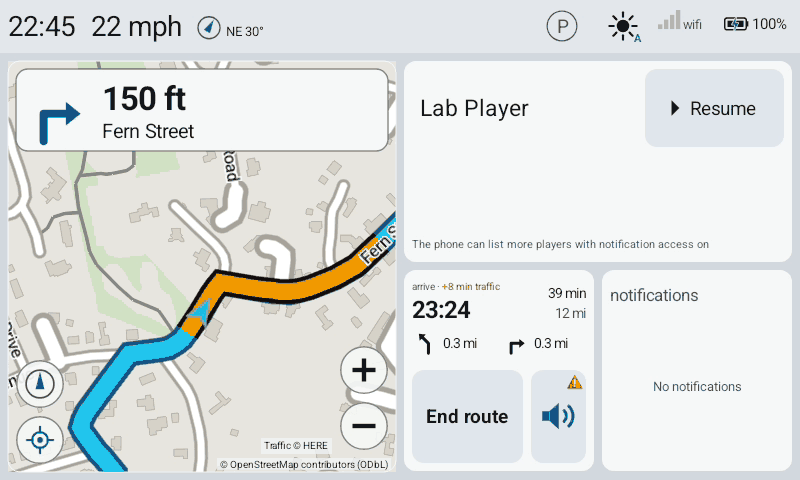
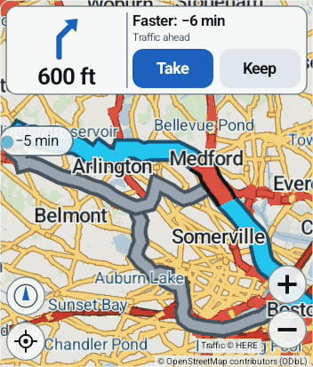
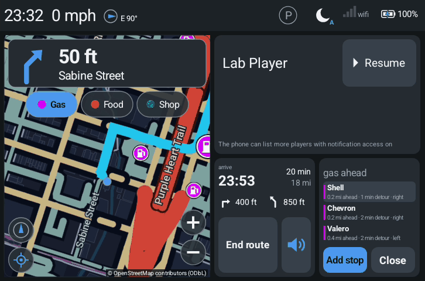

# Navigation

HeadLink draws its own map on the car screen, routes offline on the phone, follows the
vehicle along the route, re-routes when it leaves it, and sends turn-by-turn to the
truck's instrument cluster. Everything here works offline except live traffic, which is
opt-in. The operator supplies all the data (map, routing tiles, OsmAnd maps); how to get
it onto the phone is in [data.md](data.md).

This doc covers the map data, routing, guidance and the cluster. How the map pane, turn
card, trip panel and tiles look on the car screen is in [dashboard.md](dashboard.md).
Spoken turn prompts and announcements are in [audio-and-speech.md](audio-and-speech.md).

Code is in `app/src/main/kotlin/com/jw6ventures/headlink/` unless a path says otherwise.

**One privacy rule runs through all of it** (spec.md §10). A destination, its label,
coordinates, route geometry, road names and the cluster's instruction text never go into
the saved report or the event log. Reports carry counts, durations, choices and the
*source* of a destination (`send`, `favorite`, …), nothing more. The lab checks this by
grepping reports for marker strings.

| Part | Main files |
| --- | --- |
| Map | `MapEngine.kt`, `MapData.kt`, `MapAssets.kt`, `MapReadGuard.kt`, `MapLoaderInterrupts.kt`, `app/src/main/resources/assets/oaa/dashboard-{dark,light}.xml` |
| Routing | `vendor/brouter/`, `Router.kt` (`RouteRequest`, `Route`, `Router`, `RoutePlanner`), `Routing.kt`, `RoutingData.kt`, `RouteOptions.kt` |
| Destinations | `DestinationParser.kt`, `DestinationActivity.kt`, `Navigation.kt`, `NavigationStore.kt`, `Favorite.kt`, `Favorites.kt` |
| Guidance | `Guide.kt`, `RouteFollower.kt`, `Maneuvers.kt`, `app/src/main/kotlin/btools/router/VoiceHintReader.kt`, `StreetNames.kt`, `ExitSigns.kt` |
| Cluster | `core/aap-session/src/navigation.rs`, `core/aap-session/src/projection.rs`, `NativeBridge.submitGuidance` |
| Preview, alternatives | `PreviewActivity.kt`, `RoutePreview.kt`, `LiveAlternatives.kt` |
| Live traffic | `Traffic*.kt` |
| OsmAnd maps | `Obf*.kt`, `AddressQuery.kt`, `AddressSearch.kt`, `PhoneSearch.kt`, `PoiMarkers.kt`, `SearchAhead.kt`, `AheadSearcher.kt` |

## Maps

**What.** The map is Mapsforge `.map` data drawn by VTM 0.25.0 (`org.mapsforge:vtm*`,
pinned from Maven Central and checksummed in `gradle/verification-metadata.xml`; 0.25.0
is the last release there, and newer ones are on JitPack only).
`MapEngine` renders it into its own off-screen framebuffer on the scene thread, and the
dashboard composites that under its chrome. No VTM source is changed: the glue is a `Map`
subclass (`MapEngine.PaneMap`), an asset adapter and the three renderer hooks driven by
hand.

**Several maps at once.** `MapData.resolveAll` returns every installed map, and
`MapEngine.openTileSource` draws them as one through VTM's `MultiMapFileTileSource`, with
de-duplication on so a border where two extracts overlap is not drawn twice. Nothing
switches when a drive crosses from one extract to the next. One file that fails to open
costs only its own region. A newer extract replaces an older one only under the same file
name; a differently named copy is drawn beside it. Maps and tiles can be deleted from the
Maps tab.

**Import.** `MapData.installInto` streams into a staged file and renames it (4 GiB
ceiling). `MapData.checkHeader` compares the file's length with the length its header
declares, so a truncated copy is refused at import rather than showing as an empty pane
on a drive. Files over 2 GiB read correctly in VTM on ART.

**Theme.** The map uses the project's own themes, `dashboard-dark.xml` (night) and
`dashboard-light.xml` (day), loaded through `StreamRenderTheme`. A theme that fails to parse
falls back to VTM's NEWTRON rather than a blank pane. Which theme is in force is the
dashboard's day/night choice ([dashboard.md](dashboard.md)). Rules that matter when
editing a theme:

- **Order is draw level.** VTM gives each instruction a level from its position in the
  file. Each theme is two passes over the same match tree: every casing, then every
  surface, with rail and paths below and labels above. Casing and surface declared
  together put a trunk's casing over a residential street's surface and scar every
  junction.
- **The Mapsforge writer rewrites tag values.** The stock writer's tag mapping stores
  `toll=yes` and `toll=true` as `toll=tl_yes`. Rules written as `yes|true` / `~|no|false`
  matched nothing, and every toll road in Texas drew no line at all (names still showed,
  because the label pass has no toll condition). The rules are now `tl_yes|yes|true` and
  the exact complement `-|tl_yes|yes|true`. Before writing a rule on a tag value, check
  `tag-mapping.xml` in mapsforge's `mapsforge-map-writer/src/main/config/`, and write a
  split as `v="a|b"` plus `v="-|a|b"` so every value lands in exactly one branch. A branch
  that matches nothing fails silently.
- **Label size is set by `CanvasAdapter.dpi`** (240, `MapEngine.TARGET_DPI`). It scales
  fonts and line widths together. VTM drops a path label wider than its way
  (`LabelPlacement`), so a larger dpi (320 was tried) strips the names off most suburban
  streets. Labels carry explicit priorities, lower wins, with street names above place and
  water names.

**VTM traps that fail silently** (empty pane or missing chrome, no error). Each was found
by the emulator lab, never by a build or host test:

- VTM's jars carry their shaders and themes as classpath resources, not Android assets.
  `MapAssets` reads them through the classloader and must prefix `assets/`;
  `MapEngine.start` checks for `assets/shaders/base_shader.glsl` first.
- Never `close()` a `MapFileTileSource` after opening it to validate: the layer reads
  through it.
- VTM owns global GL state. Blend, depth, stencil, cull and scissor are set again every
  frame, and vertex-attribute enables are saved and restored around compositing.
- `Map.setTheme` throws on a map with no vector layer. `MapEngine` records whether a tile
  source was installed and skips theming without one, so a first run with no map data
  projects a "no map data" pane instead of crashing.
- **A failed block read becomes an empty tile.** VTM's `MapFile.processBlocks` logs a
  warning and the tile completes as `SUCCESS`, cached and never retried. `MapReadGuard`
  listens on VTM's `java.util.logging` loggers and turns a warned tile into `FAILED`, so
  VTM retries it on the next fix, up to 3 tries. The report's `map_engine` line carries
  `map_reads`, `map_read_failures` and `map_read_gave_up`.
- **A theme switch can kill a tile loader.** VTM pauses loaders with
  `Thread.interrupt()`, and an interrupt mid-read closes the loader's `FileChannel` for
  good. `MapLoaderInterrupts` clears a stale interrupt before each query and gives an
  interrupted loader a fresh data source.
- **A map full of zeros reads as an empty map with no warning.** A bad download of a large
  extract drew only the route line, with `map_read_failures=0`. The tell is in the report:
  every route shows `routing_named_roads=0/N` (see [Street names](#street-names)). The
  header length check cannot catch it; re-fetch the file.

**Verified:** on the truck daily (map follows the vehicle). Toll-road rendering was
checked against VTM's own rule matcher; the day theme and `MapLoaderInterrupts` in the lab.

## Routing

**What.** BRouter 1.7.10, vendored as source in `vendor/brouter/` (pin, provenance and
re-sync steps in `vendor/brouter/README.md`), with its `car-vario.brf` profile. Routes are
computed on the phone from operator-supplied `.rd5` tiles.

**Why BRouter, and why vendored.** BRouter is pure Java with no transitive dependencies
and the smallest data of the candidates; GraphHopper (runtime bytecode generation),
Valhalla (native Boost/Protobuf stack) and OSRM (no Android port) were rejected. Writing a
router over the `.map` data is not an option: `.map` carries no routing topology. BRouter
publishes **no Maven artifact at all** (only a GitHub zip and JitPack), so nothing could be
pinned in `verification-metadata.xml`. Vendoring the five runtime modules (101 files) is
the only option where a reproducible offline build needs no argument.

**Held unmodified** (spec.md §13). Re-syncing is a delete and re-copy of the five
`btools/` directories, then a diff against upstream and two clean builds compared.
Constraints that follow:

- `RoutingContext.setModel` instantiates the path model named inside the `.brf` with
  `Class.forName`. Minification is off; `app/proguard-rules.pro` already keeps the
  `OsmPathModel` subclasses. Without that, minifying breaks routing at the first route, at
  run time.
- The module is a plain `java-library`, so an Android API entering it fails the build.
- `VoiceHint`'s command is package-private. `btools/router/VoiceHintReader.kt` is our own
  file in that package, in the app tree, that only reads it. A re-sync that renames the
  field fails at compile time; `GuidanceTest` pins the command numbers.

**Data.** `RoutingData` keeps tiles in `files/routing/segments/` and the profile in
`files/routing/profiles/`. BRouter reads the profile from a `File` with `lookups.dat`
beside it, so `RoutingData.installProfile` copies both out of the APK's resources, and only
when they differ: BRouter's profile cache keys on the file's modification time. Tiles are
a 5°×5° grid; **BRouter finds a tile by its file name only**, so import keeps the tile name
wherever it appears (`W100_N30 (1).rd5` installs as `W100_N30.rd5`) and refuses a name
with no tile in it. Import streams (512 MiB ceiling) and runs BRouter's own header check
against the installed `lookups.dat`, so a tile built for a different lookup version is
refused at import rather than failing the first route. A route that leaves the installed
tiles fails with BRouter's "datafile W100_N25.rd5 not found", which names the tile to get.

**The engine** (`Router.compute`, `Router.computeAt`):

- `quite = true`, or BRouter prints every route to stdout as GPX.
- `turnInstructionMode = 3`. `car-vario` leaves it at 0, and at 0 BRouter derives no
  maneuvers at all.
- `memoryclass = 64` MiB of node cache, upstream's default. Austin to Denver (1,460 km over
  four tiles) routes within it.
- Via points (one), `startDirection`, no-go points and alternatives are passed through;
  see the sections below.

**The thread.** `RoutePlanner` runs every search on one daemon thread, `aap-route`,
because BRouter's parsed profile is a process-wide static. A newer request terminates the
running search instead of queueing behind it, and every request is answered once. The
ceiling is 300 s per search (`RoutePlanner.MAX_RUNNING_MS`). `RoutePlanner.explore` runs
background searches (alternatives, search ahead) only while no route request waits, and
any request stops them. The thread runs at nice 4: behind the render and encoder threads
at 0, but short of `THREAD_PRIORITY_BACKGROUND`, which moves a thread into Android's
background group and its little cores.

**Speed: time CPU work on a release build only.** On the Pixel a 94 km route took 24 s in
the debuggable APK and 0.8 s in release; ART runs debuggable code largely unoptimised.
Thread priority made no difference. Emulator lab timings (always debug) say nothing about
speed. `tools/android-build.sh` writes `app-release-debugsigned.apk`, which installs over a
debug build and keeps app data.

**Swapped signs.** A destination outside every tile whose mirrored longitude is covered
gets "did you mean −97.66843?" (`DestinationParser.mirroredLongitude`). Coordinates are
always `lat,lon`; a swapped pair is still valid numbers.

**Verified:** routing and re-routing on the phone during drives, release build. Multi-tile
routing on the host with real tiles.

## Route preferences

Maps tab → **Route preferences** (`RouteOptions`, stored by `AppSettings`). The road
switches are the profile's own parameters, sent as BRouter key values; the vendored
profile is unchanged. They make roads costly, not closed.

| Setting | Default | BRouter |
| --- | --- | --- |
| Avoid highways / toll roads / unpaved roads | off | `avoid_motorways`, `avoid_toll`, `avoid_unpaved` |
| Go around towns | off | `consider_town` |
| Allow tracks | off | `use_offroad` |
| Top speed | **75 mph** (121 km/h), 56 to 85 mph | `vmax` |
| Time adjustment | as estimated, −15% to +30% | `Route.withTimeScale` on every time |
| Learn my pace | **on** | `PaceTracker` |
| Show other routes on the map | on | `LiveAlternatives` |

**Why 75 mph.** `car-vario` ships with `vmax` 90 km/h (56 mph), which timed every untagged
Texas interstate at 56 mph: Austin to Dallas came out at 3 h 42 min against about 3 h
driven. At 121 km/h it is 2 h 56 min. A higher top speed also makes highways more
attractive, so it changes routes too.

**Learn my pace** compares, between on-route fixes, how far BRouter's time-to-go fell with
how much time passed. It starts at the first fix where the estimate falls (parking with a
route up does not count), skips fixes off the route or over a 30 s gap, phases in between
2 and 10 minutes of driving, and is held to 0.67–1.5. It applies to the time to the
destination, not to the next turn; a re-route keeps it and a new destination resets it.

A change that can alter the route recomputes the route on show from where the vehicle is
(`Navigation.optionsChanged`).

**Two BRouter traps, both handled in `Router` without touching `vendor/`:**

- **The profile cache mixes up switches.** `ProfileCache` keys on the *sum* of the key
  values' hash codes, so `avoid_toll=1 avoid_motorways=0` and the reverse collide and the
  second route silently reuses the first one's switches. `Router` calls
  `ProfileCache.setSize(1)` whenever the parameters change.
- **Long trips fail above 90 km/h** with "error re-tracking track": BRouter's final pass
  gives up when it costs more than 5,000 over the search's figure, and the kinematic
  model's two figures drift apart over long trips (Austin to Lubbock failed at 113 km/h
  and up, Austin to Denver at 105). `Router.computeStepping` retries that failure only,
  one top speed lower each time, down to 90, which never failed. The route records the
  speed used (`routing_top_speed_used_kmh`). Denver went from 15 s to 63 s on the desktop.

Not offered: avoid ferries (needs a profile edit), shortest route (the kinematic profile
has no distance mode), turning re-routing off.

**Verified:** host tests on the Texas tiles. The 75 mph and Learn my pace defaults are not
confirmed against real drives.

## Position source

Guidance, the map and every route start follow one order:

1. **The vehicle's fix** from the head unit's sensor channel (`EVENT_VEHICLE` →
   `VehicleReading` → `Guide.onFix(…, "vehicle")`). Scales of the raw values are inferred
   by vote over many readings; see [protocol.md](protocol.md).
2. **The phone's fix** (`PhoneStatus`, GPS and network providers), only while the vehicle
   has none. It needs the location grant, which the app asks for only from Setup.

A new route's start (`Navigation.start`) is the vehicle fix while projecting, else a phone
fix no older than 120 s, else one `getCurrentLocation` request. With none, the destination
waits (`routing_destination_waiting=true`) and routes on the next vehicle fix. The sensor
channel answers before the video starts, and the session forwards a fix only when it
changes, so a parked vehicle sends one fix before any pipeline exists; it is held and
replayed when the pipeline starts, and that also wakes a waiting destination.

The direction of travel for a re-route is measured from the fixes over the last 15 m
(`Guide.HEADING_BASE_M`), not from the head unit's bearing field.

**Verified:** vehicle fixes on the truck. The phone as the guidance fix source has run only
on the emulator.

## Destinations

A destination is coordinates plus a label. Every source ends in `Navigation.set`, which
checks that a tile covers it, replaces any route on show, and routes.

| Source | How | Report label |
| --- | --- | --- |
| Share sheet text (OsmAnd "Message", any app) | `DestinationActivity`, `ACTION_SEND text/plain` | `send` |
| `geo:` link (OsmAnd "Geo", Contacts, Calendar) | `DestinationActivity`, `ACTION_VIEW geo:` | `view` |
| Home's box: a point, a `geo:`, an OsmAnd link, or two points | `ConnectionActivity` | `typed` |
| Address search suggestion | Home's box, see [OsmAnd maps](#osmand-maps-search-and-places) | `search` |
| Long press on the projected map | `MapControl`, 800 ms within the pan slop, read at lift | `map` |
| A row of the favorites tile | dashboard | `favorite` |
| Go on a POI marker's card | dashboard | `map-poi` |
| Debug lab intent | `lab_route` | `lab` |

**Why shares from OsmAnd.** OsmAnd already does offline address search over maps the
driver keeps synced. Rejected: a Mapsforge `.poi` file (no house numbers), building an
address index from OSM (hundreds of MB per state plus a pipeline), and Android's
`Geocoder` (online, and usually absent on GrapheneOS). Typed address search over OsmAnd's
own files came later and complements shares.

**`DestinationParser`** (pure JVM, `DestinationTest`):

- `geo:` URIs: `q=lat,lon(label)` wins over the path; RFC 5870 parameters are skipped;
  labels are percent-decoded, stripped of control characters, capped at 200 characters.
- Share text: the first `geo:` line, else an `osmand.net/map?pin=` (or older `/go?lat=&lon=`)
  link, else exactly one bare `lat,lon` with a decimal point in both halves. The OsmAnd
  link's `#zoom/lat/lon` fragment is ignored: it is where the sender's map was looking.
- Refused, with a reason: `address-only` (`geo:0,0?q=<text>`, and `geo:lat,lon?q=<text>`,
  which Android defines as "search near"), and `no-location` (nothing readable, out of
  range, `NaN`, `0,0`). A route to a guessed address is worse than none.

`DestinationActivity` has no window (`Theme.NoDisplay`): it parses, toasts and finishes,
so the driver stays in the sharing app. The manifest adds no permission for it.

**The destination and route are saved** (`NavigationStore`, `files/navigation/current.bin`,
the preview's file format, version 3): the destination, its label and source, a chosen via
point, and the route itself, plus whether traffic shaped it. It is written off the main
thread when the route changes, deleted when the route is cleared or ends, and read when the
main process starts. The route is kept whole, not as something to recompute, because a
route set from the couch would not recompute the same from the truck; a restored route is
joined or re-routed like any other. The report says only `routing_restored=route|destination|-`.

**Verified:** shares, the `geo:` path and the saved route in the emulator. A real OsmAnd
share on the Pixel has not been recorded; the long press only in host tests (the lab
receiver cannot hold a touch).

## Favorites and the recent slot

`Favorite` (pure) and `Favorites` (preferences file `favorites`) hold up to 50 saved
places, names up to 60 characters. They are edited on the phone: add (prefilled with the
current destination), remove, drag to reorder, "Move to top". Changes reach a running
dashboard live through a `Favorites` listener in `ProjectionService`. A row press on the
dashboard's favorites tile routes there with source `favorite`.

**Arrival fills one recent slot, never the saved list.** `Navigation.arrived` (called from
`Guide`) calls `Favorites.setRecent`: one slot (prefs key `recent`) that each arrival
replaces. `Favorite.tile(saved, recent)` puts it at the top of the dashboard tile with a
history icon, unless it is within 50 m of a saved place, which is then listed once,
unmarked. An earlier version added every arrival to the saved list; the owner did not want
every destination ever as a favorite. Don't bring that back. Arrival also stops
`NavigationStore` saving the trip, so unplugging during the "You have arrived" hold does
not restore it next drive.

Tile drawing, scrolling and row sizes are in [dashboard.md](dashboard.md).

**Verified:** host tests and lab renders. A row tap has not been seen to route on the
truck.

## Guidance

`Guide` (main thread) feeds every fix to a `RouteFollower`, publishes the next maneuver to
the cluster, the dashboard's turn card and trip panel, and the voice prompts, and re-routes.
It runs with or without a projection.

**Following** (`RouteFollower`, pure JVM). A fix is snapped to the route by flat
projection, over a window of 1 km ahead and 50 m behind while on the route, and the whole
route otherwise. Everything shown (distance and time to the next maneuver and to the
destination) derives from that one position, so the figures cannot disagree with each
other.

| State | Rule |
| --- | --- |
| `JOINING` | a new route, until a fix is within 40 m; gives up as off-route only beyond 250 m |
| `ON_ROUTE` | within 40 m (`ON_ROUTE_M`) |
| `OFF_ROUTE` | beyond 40 m for 4 s **and** 3 fixes |
| `ARRIVED` | within 30 m of the end |

The step cursor only moves forward while on the route, so GPS jitter back across a turn
just taken does not put that turn back up.

**Maneuvers.** `Router` keeps each BRouter voice hint's index, command and roundabout
exit; `Maneuvers.of` maps the command to a raw `ManeuverType` value and an instruction.
The mapping is a reading of two schemas: `RNDB` → counter-clockwise roundabout (34) with
its exit, a 180° U-turn → left, `EL`/`ER` → slight off-ramps, `OFFR` and beeline hints
skipped. **BRouter never puts its `END` hint in a track**, so the follower adds the
`DESTINATION` step (39) itself, once. Times come from BRouter's own time at every route
point (`OsmPathElement.getTime()`), so a time to a maneuver moves with the route's speed
model, not the vehicle's momentary speed.

**The time to the destination** is BRouter's time ahead, scaled by Learn my pace, plus
live traffic's delay ahead (`ArrivalTime.shown`). The pace keeps learning from BRouter's
own estimate, never the shown one, so a jam is not counted twice. The cluster, the trip
panel and Home all use this one figure.

**Re-routing.** Off the route, `Guide` asks `Navigation.route(reroute = true)` from the
vehicle with its heading, and the cluster says `REROUTING`. It asks again after 15 s if
still off. A new route is placed at once from the fix in hand, so the cluster goes straight
from `REROUTING` to the first maneuver. A failed re-route keeps the old route on the map; a
vehicle back on it is guided along it again.

**No route yet.** BRouter places a start only within a few hundred metres of a road the car
profile can use, so a destination set off road (a field, a long private drive, a lot whose
aisles are not mapped as roads) can come back with no route. The destination is kept, and
`Navigation.retry` asks again from each fix once 10 s have passed and the vehicle has moved
50 m from where the last request started, or after 60 s wherever it is, until a route
arrives. A failed first route also drops any route still followed from an earlier
destination. Meanwhile the dashboard's turn card says `Finding route…` (computing, or
waiting for a position) or `No route yet, retrying…`, and the trip panel keeps End route;
the cluster stays idle. The report counts `routing_failures` and `routing_retries`.

**A destination behind a gate.** BRouter snaps the destination to the nearest way the car
profile can use, and checks, with a short search from it, whether that way's network is cut
off; if so it excludes it and snaps again. Upstream stops that check at 500 links, which
catches a lone parking aisle but not a fairground's or a campus's lots and drives joined to
the public road only through a gate or a private way: a pin on the Travis County Expo Center
(2026-10-31) stayed snapped inside and failed with "no route". `Router.widenIslandCheck`
raises the limit to 20,000 links (`ISLAND_CHECK_LINKS`), so such a network is found and
the route ends at the nearest road the vehicle can reach. BRouter is held unmodified, so
the limit and its pair set are set by reflection on two private fields; `RoutingTest` pins
both names.

**Why re-routes don't turn round.** BRouter honours `startDirection` only as a flat 40 s
U-turn at the start, so a re-route after a missed turn began by going back the way the
vehicle came, and a second re-route followed seconds later. `Router.behind` adds a
weighted no-go circle 12 m behind any request with a heading (radius 10 m), priced at
180 s of delay at the request's top speed. BRouter tests the start segment against no-go
points only past the snapped start point, so going forward never pays it. It is weighted,
not hard, so a dead end still turns back. The 180 s is a first guess, open to tuning.
Host-tested only.

**Via points.** A route keeps to `Navigation.via` (a chosen alternative or an added stop),
re-routes included, until the vehicle reaches it (within 50 m) or is on the route 50 m past
it (`ViaRelease.passed`). A re-route round a closure drops the via point.

**Arrival.** The cluster goes `INACTIVE` at once. "You have arrived" stays on the dashboard
for 30 s (`Guide.ARRIVAL_HOLD_MS`), then the route ends itself.

Thresholds (40 m, 4 s, 3 fixes) are reasoned, not measured; the report's
`guidance_max_on_route_offset_m` is how a drive says whether 40 m is generous.

**Verified:** on the truck: a route followed on the map and the cluster, every turn icon
sensible, and a re-route after a deliberate wrong turn. Arrival, `Router.behind`, the phone
fix source and via release are lab or host only.

## Instrument cluster turn-by-turn

**What.** Maneuvers go to the truck's own instrument cluster over the `navigation` channel
(service type 10; channel 11 on Ford), as **semantic messages only**:
`NavigationState` (0x8003), `NavigationNotification` (0x8006: step, maneuver, road names)
and `NavigationNextTurnDistanceEvent` (0x8007: step distance, seconds to step and to
destination, current road). No image bytes, no lanes (BRouter has none), no arrival-time
string (the format is unrecorded and the source does not know the car's clock).

**What Ford advertises, and what it needs.** Ford's descriptor says
`minimum_interval_ms=400`, `type=2` (the schema calls it `NEXT_TURN_IMAGE`) and no image
dimensions. It needs no image: SYNC 4.0 draws its own icon, road name and distance
countdown from the semantic stream. `type` is kept as the integer and nothing branches on
its name; the enum is marked unverified upstream.

**The sequence** (`core/aap-session/src/projection.rs`, `navigation.rs`):

1. Open the channel during setup, opt-in and non-fatal.
2. Ask for navigation focus on the **control** channel (messages 13/14,
   `NAV_FOCUS_PROJECTED`), not on the navigation channel.
3. Treat `InstrumentClusterStart` (0x8001) as confirmation when it comes, never as a
   precondition (spec.md §8.1). **Ford never sends it**: it opens the channel in 5 ms and
   grants focus anyway. A source that waited for it sent nothing to this truck. So
   "Send even if the cluster stays silent" (`navigation_force`) is **on by default** and
   must stay on for this vehicle. The unforced path still exists for a head unit that
   announces.
4. With a route: `ACTIVE`, then a notification and a distance per update. `REROUTING`
   while re-routing (only from `ACTIVE`). `INACTIVE` on arrival or with no route; focus is
   kept so the next destination needs no new handshake.
5. At session end: `INACTIVE`, and the cluster handed back by asking for
   `NAV_FOCUS_NATIVE` (the enum has no release value).

**Timing.** The interval used is the larger of the head unit's floor and the source's own,
1000 ms by default (`navigation_interval_ms`), so on Ford the source's 1 s binds, not the
400 ms floor. One update is a notification and a distance together, and the interval is
enforced across the pair. The maneuver is restated every 5 s even if unchanged, so a
cluster that was not listening learns it. When the state returns to `ACTIVE` after a
re-route, the state goes at once but the new maneuver waits for the interval; clearing the
deadline there once broke the head unit's floor.

**Focus quirks.** Ford answers one focus request with two `PROJECTED` responses, and the
message has no `unsolicited` flag, so handling is idempotent. A `NAV_FOCUS_NATIVE` answer
is not a permanent refusal: a later grant starts the sequence. `InstrumentClusterStop`
pauses without withdrawing state. Responses after our own hand-back are ignored (the
Prodigy lab receiver echoes the request payload back, including the hand-back).

**Units** (`Units` in `navigation.rs`): imperial by default (feet under 1000 ft, then
`DISTANCE_UNIT_MILES_P1` in tenths), or metric. Tenths is a reading of a field documented
only as "one-decimal precision"; `display_text` carries the same distance as a string.
Imperial renders on the truck; metric has never been on a vehicle.

**Road names** go three ways: in the instruction ("Turn right onto Main Street"), in the
step's `road_info`, and the road being driven as `current_road` in 0x8007. Which of them
SYNC 4 draws where is unrecorded.

**Settings** (Settings tab → Instrument cluster): Turn-by-turn on the cluster (on), Cluster
distance units, Send even if the cluster stays silent (on), Demonstration sequence (off;
plays a fixed six-leg script instead of the route, for checking the cluster parked). The
app writes `navigation_source=route` unless the demonstration box is ticked.

**Verified:** on the truck: the scripted sequence and a followed route, with icons that
matched the turns. Not seen: what the cluster shows when a route ends, whether `_P1` is
read as tenths, which line shows which road name, metric.

## Street names

BRouter's `lookups.dat` has no `name` tag, so a route knows what each maneuver is but not
onto what. `StreetNames` (pure JVM over VTM's own `MapFile` reader) reads the names from
the same Mapsforge files the dashboard draws, on the routing thread after the search
(`RoutePlanner`'s `annotate`). It cuts the route into stretches at the start and at every
maneuver, samples each every 20 m from 12 m to 200 m past its start, and names it after
the road a majority of samples lie within 6 m of. Starting 12 m out keeps samples off the
junction; the majority rule stops a turn onto an unnamed driveway borrowing the name of
the street it leaves. The label is `name`, else `ref` ("US 183 / TX 45"). A failure leaves
the route unnamed, never failed.

`Route.roadStarts`/`roadNames` carry them; `Route.roadAt` gives the name at a point (live
traffic's offer reason uses it too, never HERE's descriptions). The report says
`routing_named_roads=<named>/<stretches> routing_naming_ms=…`. Motorway ramps are usually
unnamed in OSM.

**Verified:** host tests on a real route and map, and the lab. On the truck a road name
appears on the cluster; which field it comes from is unknown.

## Exit signs

**What.** At a highway exit the turn card, the cluster and the voice give the exit number
and where the ramp goes: "Exit 23A: I 35 South / Waco" on the card and as the cluster's
road name, "Take exit 23A toward I 35 South / Waco" as the cluster's instruction, and
"Take exit 23A toward Interstate 35 South, Waco" spoken (just "Take exit 23A" with street
names off in the voice settings). It needs OsmAnd maps covering the road
([OsmAnd maps](#osmand-maps-search-and-places)); without them nothing changes.

**Why OsmAnd's files.** Neither other source has the data. BRouter's `lookups.dat` keeps
no `motorway_junction` and no `destination`. The Mapsforge writer keeps an exit's point and
its `name`, but VTM's `MapFile` reads only a point's name, house number and elevation, so
the junction's `ref`, which is the exit number, is gone, and the writer's default tag
mapping keeps no `destination` at all (checked against `mapsforge-map-writer` 0.25.0 and
VTM 0.25.0 sources). OsmAnd's routing section (`OsmAndRoutingIndex`, field 9) keeps all of
it on the same OSM ways BRouter drives.

**The reader** (`ObfRouteReader`, behind `ObfFile.roadWays`). Written from OsmAnd's
`BinaryMapRouteReaderAdapter` and `RouteDataObject` at `b75433b`. The table of contents
notes where each routing section is and reads nothing more; the section's rules and root
boxes are read on the first query. Rules are a tag and value each, numbered from 1 in
order unless they carry an id. Root boxes have absolute zoom-31 bounds and children deltas
from their parent; a box outside the query is skipped with everything under it, and the
`basemapBoxes` are never read. A box's `shiftToData` is a big-endian offset from the box's
own body to a varint-prefixed `RouteDataBlock`. Points are zoom-31 positions shifted right
by 4 (about 0.3 m), deltas from the box's left and top. Text tags (`destination`, a
junction's `ref`) are rule ids paired with an index into the block's string table. Box
headers and the last 64 decoded blocks are cached per file.

**The matching** (`ExitSigns`, pure JVM, run with `StreetNames` in `RoutePlanner`'s
`annotate` and on live traffic's alternatives). For each maneuver except the destination,
roundabouts and U-turns, the roads within 260 m are read. The route past the maneuver
(`StreetNames.samples`) must lie, by a majority of samples within 8 m, on one `*_link`
road: a "keep left" that stays on the highway at an exit gets no sign. The destination is
the ramp's `destination:ref` then `destination` (the `:forward` or `:backward` form for
the way the ramp is driven, when it has one), OSM's `;` read as " / ". The number is the
ramp's `junction:ref`, else the `ref` of a `motorway_junction` point within 40 m of the
maneuver or the ramp's first point, OsmAnd's `getExitRef` order; an on-ramp from a surface
street has no junction near it, so it gets a destination and no number. With no
destination, the junction's `exit_to`, the ramp's `junction:name` or the junction's `name`
stands in. A file that fails to read leaves the maneuver unsigned.

`Route.exitSigns` holds one `ExitSign` (or null) per maneuver, kept through scaling,
naming, `remainder` and the route file (version 4; versions 2 and 3 still read).
`RouteFollower` puts the sign's label in `NextStep.onto` and its instruction in
`NextStep.instruction`, so the card and cluster need no change of their own.

**Not done.** Routes adopted from the phone's route preview carry no signs until the next
re-route: the preview runs in its own process, which holds no OsmAnd files. Lane guidance
is in the same OsmAnd data and still out of scope.

**Verified:** host tests on a synthetic file built from the proto (`ExitSignsTest`). Not
yet checked against a real OsmAnd file or on the truck.

## Route preview and alternatives

**Phone preview.** Home → **Preview route and alternatives** opens `PreviewActivity`: the
route fitted to the screen with pinch, drag, + / − and "Whole route", the current route
and up to two alternatives listed with time, extra time, distance and the road each
drives furthest on ("via I 35"). **Use this route** follows the chosen one. It needs no
projection: set the route on the couch, then drive.

**Why its own process (`:preview`).** VTM keeps its settings in statics (dpi, tile size,
its "main thread", cached GL state) that `MapEngine` sets for the head unit. A phone map in
the same process would reset them under a running projection. `SourceApplication` does no
startup work in `:preview`. The processes share files only: the main process writes
`files/preview/request.bin` (route, ends, options and `Routing.token`); the preview writes
`files/preview/choice.bin`; `Routing.adopt` takes the choice only if the token still names
the route on show, so a choice made stale by a re-route is refused. Both files are
versioned, written to `.part` and renamed, and bounds-checked on read.

**Why via-point alternatives** (`AlternativeFinder` in `RoutePreview.kt`). BRouter's own
alternatives (`alternativeIdx`) charge every road an earlier route used, with a penalty
fixed inside a `final` class, so they share under 10% of the best route and run 30 to 100
minutes longer. The finder uses BRouter's alternative *k* only to find another corridor:
it takes points 30%, 50% and 70% along it that are at least 1 km (or 2% of the trip) off
the best route, routes the ordinary best route **through** each, drops any that turn back
at the via point or share over 80% of points with one already offered, and keeps the
fastest. Austin to Temple: best 65 min, BRouter's alternatives 91 and 101, offered 71 min.
Up to 11 searches for two alternatives.

**Live alternatives on the car screen** (`LiveAlternatives`). While a route is followed on
the head unit (not re-routing, more than 3 km left, "Show other routes on the map" on), it
searches from a point about 45 s ahead of the vehicle (at least 400 m), first 30 s after a
route starts, then every 5 minutes. Each is a grey line with a "+N min" bubble 300 m into
the part it does not share; tapping the bubble routes through its via point. Not shown:
more than 10 minutes longer, or a quarter of the time left when that is more. An
alternative disappears once the vehicle passes the last point it shares. Two lab lessons
behind the numbers: searched from the vehicle, alternatives split at the next junction,
which was passed before the search ended; and BRouter's snapped ends are never shared
nodes, so sharing allows 50 m at the ends.

**Verified:** preview and saved route in the emulator; live alternatives in the lab. A
bubble tap has not been seen on the truck; the preview has not run on the Pixel.

## Live traffic (HERE)

Older code comments call this P9.

**What.** Opt-in (off by default), with the operator's own HERE API key. While a route is
followed, the app fetches HERE Traffic API v7 flow and incidents for the route ahead,
colours the route line ahead by congestion, adds the delay to the arrival time, re-routes
round a closure ahead, and offers a faster way round a jam. Setup is on the Maps tab →
**Live traffic** card; getting a key is in [data.md](data.md). `INTERNET` exists for this
alone (spec.md §5.2, APP10 as amended).

**Why HERE.** TomTom's developer terms (clause 7) forbid "Automotive Usage", defined to
include screen replication and naming Ford Sync, and its free tier is evaluation-only.
HERE's Platform Terms 6.3a carve out a phone projecting onto a car display, and 6.4a
allows combining HERE data with other data into a route with attribution. RoadEagle/TraFF
has no US feeds, Houston TranStar covers Houston freeways only, Waze for Cities is for
governments. Before planning any other commercial traffic API, check its terms for
automotive and screen-replication clauses.

**HERE's conditions, and how the design meets them:** "Traffic © HERE" on the map whenever
traffic is drawn or shaped the route or time (6.4a); HERE data is held in memory only and
replaced by the next response, never written anywhere or committed as a fixture (6.4b,
6.4j; HERE sends no cache headers); no learning from HERE data, so Learn my pace uses the
drive's fixes only (6.4f); nothing shared with other apps (6.4h); End User Terms and
Privacy Policy linked on the card (6.2). Pricing: 5,000 free transactions a month, then
$2.50 per 1,000.

**The gate** (`TrafficClient`, `TrafficSettings`). No socket opens unless traffic is on
**and** a key is saved; `TrafficSettings.repaired()` turns traffic off whenever the key is
blank, and the gate is checked again before every request. Host tests pin that the HTTP
layer is never called otherwise. The key lives in its own preferences file (`traffic`),
excluded from backup, never shown after saving, and scrubbed from every error message. A
monthly cap (default 4,500, by UTC calendar month) stops fetching; each request is counted
and stored before it is sent. Release builds always use `https://data.traffic.hereapi.com`;
a debug build honours a base-URL override only for `10.0.2.2`, `127.0.0.1` and `localhost`
(the lab's stand-in server).

**What is sent.** Only while a route is followed (on it or joining, with a fix in the last
2 minutes, or any fix while projecting, because a vehicle stopped in a queue sends no new
fixes): the box around the next 30 km of the route (Look ahead: 15, 30 or 50 km), padded
2 km, cut into cells under HERE's 1° limit (`TrafficArea`), plus the key. HERE sees roughly
where the truck is, its IP and when; not the destination or the route. Each box is two
GETs, flow first, `locationReferencing=shape`, and flow with `functionalClasses=1,2,3`
(without it a response is 50 times larger, mostly side streets). Gzip is asked for.

**Cadence** (`TrafficFeed`, main-thread state; fetch and match run on their own threads at
nice 4). First fetch at the first fix on a new route, then every Refresh interval (default
10 min). After a re-route the held response is laid on the new route at once; a new fetch
only if the old boxes no longer cover half the look-ahead, and no sooner than 60 s after
the last. A failure retries in 2 min (HERE 4xx: at the next refresh). The last good
response is dropped at twice the refresh interval: old traffic is worse than none.
Everything is dropped at once when the route ends or traffic is turned off.

**Parsing** (`TrafficJson`): a hand-written streaming JSON reader, not `org.json`, because
flow bodies run to megabytes and neither `org.json` nor `android.util.JsonReader` is on the
host-test classpath. Speeds are m/s. Sub-segments split one stretch into spans; a span that
omits free flow, jam factor or traversability inherits its stretch's, but never its speed
(HERE omits speed only on closed spans). Non-finite numbers are dropped. Both of HERE's
error shapes are read.

**Matching** (`TrafficMatch`). The route is cut into 10 m pieces; each takes the closest
HERE stretch within 15 m **whose heading agrees within 30°**, which keeps a northbound jam
off the southbound carriageway and the frontage road. A piece with no match has no data
and is drawn in the normal route colour, never as free-flowing. Levels: slow for jam factor
4–8 (amber), queuing above 8 (red), closed (dark red stipple). Only slow and queuing count
as delay (length at HERE's speed minus BRouter's time; free flow adds nothing, or empty
roads showed "+1 min"). A closure ahead needs a closed run of at least 30 m. Managed or
reversible lanes beside the route are not closures of it. HERE's lines sit within a couple
of metres of OSM's mostly, but up to 20 m on some interstate stretches.

**No-go points** (`TrafficNogos`, `TrafficCost`, `Router`). Closures become hard BRouter
no-go circles and jams weighted ones, radius 8 m, at most 150 m apart, none within 30 m of a
stretch's end (junctions), slid clear of HERE roads that cross (overpasses), capped at 300
(BRouter checks every point for every segment; ~3 ms a point a search). Because HERE's
geometry can be 20 m off, closures and jams matched to the route also get points on the
route's own line. Every request carries them while a response is held, including re-routes
and every alternatives search. What BRouter does with points, measured:

- **Per link only the last circle counts**; charges do not add up. A jam's weight is
  delay × `secondPrice(topSpeed)` ÷ (points × 16 m), with ×1.6 for HERE classes 1–2,
  whose links are longer than the spacing. `secondPrice` is the kinematic model's price of
  a second (`pw ÷ cost0`), which is what BRouter trades between routes.
- **A weighted circle after a hard one on the same link opens the closure.** Hard points
  go last, every route is checked for crossing a closure (`Router.closuresCrossed`), and a
  crossing route is searched again without the nearby weighted points, then without any.
- **A start or destination inside a closure fails.** A failed search with closures is
  retried once with every closure passable at 300 s a point (`closuresOpened`), so a
  vehicle already in a closure still gets out. Such a route never triggers a closure
  re-route, or it would loop.
- Circles have no direction: on an undivided road a jam one way charges both.

The first route of a trip has no points (nothing is fetched before a route is followed); a
closure found by the first fetch re-routes, a jam is offered.

**Closure ahead.** A closed run ahead on the followed route re-routes at once, once per
closure (`Guide.rerouteForClosure`, `routing_origin=closure`). A failed closure re-route
keeps the old route.

**The offer.** After an update with at least 3 minutes of delay ahead, one alternatives
search runs with the points (plus BRouter's own best route with them). An alternative is
offered when it saves at least 180 s counting both routes' traffic, traffic is part of why,
it leaves the route more than 30 m ahead, and it has no closure. The turn card divides:
"Faster: −7 min", a reason ("Queue on I-35E", "Traffic on …", "Closed: …", or "Traffic
ahead" when the map has no name there), **Take** and **Keep**, and the map zooms out to
both routes. Keep suppresses the same way round for the trip unless it saves 3 minutes
more. The offer withdraws itself 30 m past the split, on arrival, on a route change, or
when the delay drops. Nothing re-routes by itself for a jam. Layout of the card and the
colours: [dashboard.md](dashboard.md).

**Report.** A `[traffic]` section with counts, minutes and booleans only: never a box, a
road, a reason, HERE's error text or the key. `traffic_last_error` is a class
(`network`, `http_401`, `limit`, …).

**Verified:** the card's Test button with a real key on the Pixel. Everything else in the
emulator lab against a stand-in server (`tools/here-standin/`), all five checks passing,
and host tests on real Dallas and Austin routes. Not yet: a drive into real congestion,
release-build timings of alternatives with points, frame cost at 1080p. The side-by-side
vs stacked card choice and the night queue red being close to motorway red are open.

## OsmAnd maps: search and places

Older code comments call this P11.

**What.** HeadLink reads OsmAnd's own `.obf` map files in place, read-only, for typed
address search on the phone, Gas/Food/Shop markers on the car's map, "search ahead"
along the route, and exit numbers and signs ([Exit signs](#exit-signs)). It never routes
on OBF data, renders it, or writes anything. BRouter and
the Mapsforge map are unchanged. Settings tab → **OsmAnd maps**; folder setup in
[data.md](data.md).

**The folder** (`ObfLibrary`). OsmAnd's maps must be in ordinary shared storage, set in
OsmAnd as *Data storage folder → Manually specified* (`Documents/osmand`): Android keeps
other apps out of `Android/data` and `Android/obb`. The app takes a persisted **read-only**
tree grant, distinguished from the drop folder's read+write grant, so neither needs a
separate setting; `DropFolder.choose()` releases only earlier read+write grants. Only
`*.obf` files directly in the folder are read (not `.srtm`, `.wiki`, `World_basemap`, or
`.obf.download` partials). Files are opened through `ParcelFileDescriptor` and read with
positional `FileChannel` reads, never memory-mapped (a mapping caps at 2 GB). They stay
open while a projection or the phone screen holds them, keyed by name, size and
modified time.

**The reader** (`ObfWire`, `ObfFile`, `ObfAddressReader`, `ObfPoiReader`; pure JVM). Our
own walker against OsmAnd's `OBF.proto`, vendored unmodified in
`protocol/upstream/osmand/` with no code generated: OsmAnd frames large sections with its
own wire type 6, a 4-byte **big-endian** length (8 bytes if the top bit is set), which no
generator understands, and its offsets are big-endian too. Only the address (7), POI
(8) and, for exit signs, routing (9) sections are opened. Lessons from real files:

- **POI names are text tags, not fields 6/7.** The first run decoded every name empty. The
  same holds for `name:en`, `brand` and `opening_hours`. Schema names are not evidence.
- The address name index is never read, so OsmAnd's July 2026 change to its layout does not
  matter; only an OBF version above 2 is reported as "newer format".
- One place can appear as several atoms under one id (an airport three times); results are
  de-duplicated, best kind first.
- US files carry TIGER interpolation ranges; a range's first number often also appears as a
  plain building.
- A postcode's own point is its first address, which can be kilometres off; ZIP
  suggestions go at the median of the postcode's streets.
- Streets split by suburb carry a suffix ("Congress Avenue (Downtown)").

Decoded positions agree with OSM to within a few metres for points and small ways.

**Typed search** (`AddressQuery`, `AddressSearch`, `PhoneSearch`). On Home's destination
box: 250 ms after the last keystroke, 3 characters minimum, one background thread, a newer
keystroke cancels an older search, 8 rows. The parser yields every plausible reading (a
trailing ZIP, state, city with or without a comma, a state code that may be a street word
like "Oak Ct"), and folds street types, directions and numbered-road prefixes (FM, RM, SH,
US, I, CR) both ways. With a house number: an exact building, else an interpolated
estimate along a range ("(estimated)"), else the nearest numbers below and above, same
side of the street first, else the street itself. With no number and no street, POI names
nearby ("HEB" finds "H-E-B"). Addresses rank before places, then by street match, then
kind, city match and distance. A pick routes with source `search`. Typed text is never
kept or reported.

**Markers** (`PoiMarkers`, `PoiMarkerArt`, `MapEngine.setPois`). Gas, Food and Shop
buttons along the top of the map pane, off at every projection start. Gas is `fuel` only
(EV charging excluded); Food is restaurant, fast food, cafe, food court and barbecue; Shop
is every `shop` subcategory, resolved from each file's own category table. Markers cover
the visible pane grown by half its size on each side (so a drive does not empty it),
re-queried 500 ms after the map settles and at most every 10 s while following, at most 25
per kind by default (a setting), nearest the centre first, on a VTM `ItemizedLayer` just
under the labels. Two places of one kind and name within 75 m are one place mapped twice.
A tap opens a card in the flex tile with the name, kind, distance, an open-now line parsed
from `opening_hours`, and **Go** (source `map-poi`).

**Search ahead** (`SearchAhead`, `AheadSearcher`). While a route is followed, lighting a
button also searches a corridor of the route ahead (default 0.5 mi each side, 50 mi or to
the destination), projects each place onto the route (dropping places under 300 m ahead or outside the
corridor), and for the nearest 5 routes the
detour A → place → B, with A and B 2 km either side on the route: two short routes per
candidate instead of whole-trip ones. The detours run through `Routing.explore` with
traffic's points. The smallest detour wins, unless a stop at least 1 km nearer is within
2 minutes of it. The result is spoken (see [audio-and-speech.md](audio-and-speech.md)) and
listed on the card with **Add stop**, which makes the place the route's via point
(replacing any) and re-routes (`Navigation.addStop`). The via point is let go within 50 m
of it as well as once past it, because a vehicle leaving a station by another exit never
passes it on the route.

**Verified:** host tests against real Austin, Amarillo and Lubbock files; markers and
search ahead in the emulator lab in Austin. Nothing has run on the Pixel or the truck: the
folder grant on the real phone, search speed on a release build (target 300 ms), and Add
stop on a drive are open. OsmAnd's on-device search API was considered as a second source
and not built.
