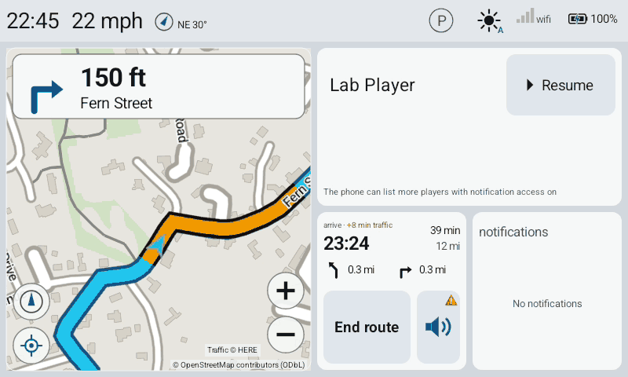
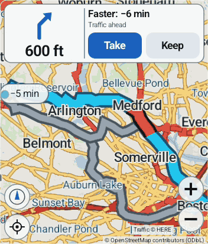
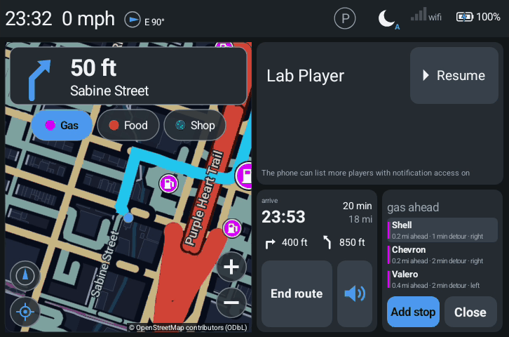

# Navigation

HeadLink draws its own map on the car screen, routes offline on the phone, follows the
vehicle along the route, re-routes when it leaves it, and sends turn-by-turn to the
truck's instrument cluster. Everything here works offline except live traffic, which is
opt-in. The map and routing data are the operator's own OsmAnd `.obf` maps, read in place;
how to point the app at them is in [data.md](data.md).

This doc covers the map data, routing, guidance and the cluster. How the map pane, turn
card, trip panel and tiles look on the car screen is in [dashboard.md](dashboard.md).
Spoken turn prompts and announcements are in [audio-and-speech.md](audio-and-speech.md).

Code is in `app/src/main/kotlin/com/jw6ventures/headlink/` unless a path says otherwise.

**One privacy rule runs through all of it** (spec.md §10). A destination, its label,
coordinates, route geometry, road names and the cluster's instruction text never go into
the saved report or the event log. Reports carry counts, durations, choices and the
*source* of a destination (`send`, `favorite`, …), nothing more. The lab checks this by
grepping reports for marker strings.

| Part | Main files |
| --- | --- |
| Map | `MapEngine.kt`, `MapAssets.kt`, `MapLoaderInterrupts.kt`, `ObfMapSource.kt`, `ObfMapTiles.kt`, `app/src/main/resources/assets/oaa/dashboard-{dark,light}.xml` |
| Routing | `vendor/osmand/`, `OsmAndRouter.kt`, `Routes.kt` (`RouteRequest`, `Route`, `RouteEngine`, `RoutePlanner`), `Routing.kt`, `RouteOptions.kt` |
| Destinations | `DestinationParser.kt`, `DestinationActivity.kt`, `Navigation.kt`, `NavigationStore.kt`, `Favorite.kt`, `Favorites.kt` |
| Guidance | `Guide.kt`, `RouteFollower.kt`, `Maneuvers.kt`, `TurnCommand.kt` |
| Cluster | `core/aap-session/src/navigation.rs`, `core/aap-session/src/projection.rs`, `NativeBridge.submitGuidance` |
| Preview, alternatives | `PreviewActivity.kt`, `RoutePreview.kt`, `LiveAlternatives.kt` |
| Live traffic | `Traffic*.kt` |
| OsmAnd maps | `Obf*.kt`, `AddressQuery.kt`, `AddressSearch.kt`, `PhoneSearch.kt`, `PoiMarkers.kt`, `SearchAhead.kt`, `AheadSearcher.kt` |

## Maps

**What.** The map is drawn by VTM 0.25.0 (`org.mapsforge:vtm*`, pinned from Maven Central
and checksummed in `gradle/verification-metadata.xml`; 0.25.0 is the last release there,
and newer ones are on JitPack only) from the OsmAnd `.obf` maps in the chosen folder,
through `ObfMapSource` ([Drawing the map from OsmAnd
maps](#drawing-the-map-from-osmand-maps)). `MapEngine` renders it into its own off-screen
framebuffer on the scene thread, and the dashboard composites that under its chrome. No
VTM source is changed: the glue is a `Map` subclass (`MapEngine.PaneMap`), an asset
adapter and the three renderer hooks driven by hand. With no maps folder chosen the
report's `map_engine` line says `error=no OsmAnd maps folder chosen` and the pane shows
the "no map data" background.

**Several maps at once.** Every map in the folder is drawn as one; a way in two
neighbouring regions' files is drawn once. Nothing switches when a drive crosses from one
region to the next.

**History.** Until 0.12 the map could also come from Mapsforge `.map` files imported into
the app (`MapData`, drawn through VTM's `MultiMapFileTileSource`), and from 0.9 that was
the fallback when no OsmAnd map had map data. The Mapsforge source, its import, header
check and `MapReadGuard` were removed in 0.12.

**Theme.** The map uses the project's own themes, `dashboard-dark.xml` (night) and
`dashboard-light.xml` (day), loaded through `StreamRenderTheme`. A theme that fails to parse
falls back to VTM's NEWTRON rather than a blank pane. Which theme is in force is the
dashboard's day/night choice ([dashboard.md](dashboard.md)). Rules that matter when
editing a theme:

- **Order is draw level.** VTM gives each instruction a level from its position in the
  file. Each theme is two passes over the same match tree: every casing, then every
  surface, with rail and paths below and labels above. Casing and surface declared
  together put a trunk's casing over a residential street's surface and scar every
  junction.
- **Check the data's real tag values.** Before writing a rule on a tag value, check what
  the source actually emits, and write a split as `v="a|b"` plus `v="-|a|b"` so every
  value lands in exactly one branch. A branch that matches nothing fails silently. (The
  Mapsforge writer stored `toll=yes` as `tl_yes`, and until the rules matched it every
  toll road in Texas drew no line at all. `ObfMapTiles` passes OsmAnd's values through
  unchanged, so 0.12 dropped `tl_yes` from the rules.)
- **Label size is set by `CanvasAdapter.dpi`** (240, `MapEngine.TARGET_DPI`). It scales
  fonts and line widths together. VTM drops a path label wider than its way
  (`LabelPlacement`), so a larger dpi (320 was tried) strips the names off most suburban
  streets. Labels carry explicit priorities, lower wins, with street names above place and
  water names.

**VTM traps that fail silently** (empty pane or missing chrome, no error). Each was found
by the emulator lab, never by a build or host test:

- VTM's jars carry their shaders and themes as classpath resources, not Android assets.
  `MapAssets` reads them through the classloader and must prefix `assets/`;
  `MapEngine.start` checks for `assets/shaders/base_shader.glsl` first.
- Never close a tile source after opening it to validate: the layer reads through it.
- VTM owns global GL state. Blend, depth, stencil, cull and scissor are set again every
  frame, and vertex-attribute enables are saved and restored around compositing.
- `Map.setTheme` throws on a map with no vector layer. `MapEngine` records whether a tile
  source was installed and skips theming without one, so a first run with no map data
  projects a "no map data" pane instead of crashing.
- **A failed block read became an empty tile** with Mapsforge files: VTM's
  `MapFile.processBlocks` logged a warning and the tile completed as `SUCCESS`, cached and
  never retried, which `MapReadGuard` turned into a retry until 0.12. `ObfMapSource` fails
  a tile with no reader open itself, so VTM asks for it again.
- **A theme switch can kill a tile loader.** VTM pauses loaders with
  `Thread.interrupt()`, and an interrupt mid-read closes the loader's `FileChannel` for
  good. `MapLoaderInterrupts` clears a stale interrupt before each query and gives an
  interrupted loader a fresh data source.
- **A Mapsforge file full of zeros read as an empty map with no warning** (history, before
  0.12): the tell was a route line on a blank pane and the report's
  `routing_named_roads=0/N`, back when street names were read from the map file. A
  zero-filled `.obf` is rejected for lacking a version field.

**Verified:** on the truck daily (map follows the vehicle), drawn from Mapsforge; the
OsmAnd-drawn map is not yet recorded on the truck. Toll-road rendering was
checked against VTM's own rule matcher; the day theme and `MapLoaderInterrupts` in the lab.

## Routing

**What.** OsmAnd's own router (OsmAnd-java, vendored in `vendor/osmand/`) over the `.obf`
maps in the chosen folder, through `OsmAndRouter`; details in [Routing on OsmAnd
maps](#routing-on-osmand-maps). There is no other engine and no setting to pick one.

**History: BRouter (P6.3 to 0.11).** Routing started as BRouter 1.7.10, vendored as
source in `vendor/brouter/` with its `car-vario.brf` profile, over operator-supplied
`.rd5` tiles. It was chosen as pure Java with no transitive dependencies and the smallest
data of the candidates (GraphHopper, Valhalla and OSRM were rejected), and vendored
because it publishes no Maven artifact. OsmAnd routing arrived in 0.8, became the default
in 0.9, and in 0.12 BRouter, its tiles, `RoutingData` and the import and drop-folder paths
were removed, along with BRouter's own traps (the profile cache keyed on a hash sum, long
trips failing "error re-tracking track" above 90 km/h, the 500-link island check). The
BRouter measurements below are kept where they explain a number still in use.

**The thread.** `RoutePlanner` runs every search on one daemon thread, `aap-route`. A
newer request terminates the running search instead of queueing behind it, and every
request is answered once. The ceiling is 300 s per search (`RoutePlanner.MAX_RUNNING_MS`,
five times BRouter's old 60 s default). `RoutePlanner.explore` runs background searches
(alternatives, search ahead) only while no route request waits, and any request stops
them. The thread runs at nice 4: behind the render and encoder threads at 0, but short of
`THREAD_PRIORITY_BACKGROUND`, which moves a thread into Android's background group and its
little cores.

**Speed: time CPU work on a release build only.** On the Pixel a 94 km route took 24 s in
the debuggable APK and 0.8 s in release (BRouter); ART runs debuggable code largely
unoptimised. Thread priority made no difference. Emulator lab timings (always debug) say
nothing about speed. `tools/android-build.sh` writes `app-release-debugsigned.apk`, which
installs over a debug build and keeps app data.

### Coverage refusal

Before any search, `OsmAndRouter` checks, on the routing thread, two points against the
routing sections of the open maps: the destination, and the via point (stop) when there is
one. The start is not checked. A point counts as covered when a box of `END_SNAP_M` round
it meets any top-level routing box, so a pin just past a map's edge that OsmAnd would snap
onto a road inside it is not refused by this check; a pass permits the search but does not
guarantee a route. Only files with routing data count, so a planet-wide basemap never
does. Without the check OsmAnd would end the route on whatever road it reached nearest, or
search to its time limit for nothing. A miss fails the request with one of three reasons:

| Reason | When | Phone text |
| --- | --- | --- |
| `NOT_COVERED` | No map covers the destination | "No OsmAnd map with roads in your maps folder covers …" (`destination_no_osmand_map`) |
| `MIRRORED` | Not covered, but its mirrored longitude is: a dropped minus sign | "did you mean −97.66843?" (`destination_mirrored`, `DestinationParser.mirroredLongitude`) |
| `STOP_NOT_COVERED` | The destination is covered but the via point (a stop) is not | `stop_no_osmand_map`, naming the stop |

**For the followed trip** (a destination set through `Navigation.set`), a coverage failure
marks the trip uncovered (`Navigation.uncovered`), is counted once per destination as a
`NO_ROUTING_DATA` refusal, and stops automatic re-routes and retries: none could succeed
until the maps change. The Home route card shows the reason's text
(`Routing.coverageText`). What the dashboard shows depends on whether a route is still
followed:

- **No route followed** (a first route that failed): the turn card says "No map covers
  this place" and the trip panel "no map here".
- **A re-route that failed** keeps the old route and its follower, so guidance continues
  along it and the dashboard shows that route's turns, not the coverage text.

**A standalone two-point request** (`lat,lon lat,lon`) that misses gets the reason's text
on Home only; it does not mark the held trip uncovered.

A new destination clears it. Choosing a new maps folder (`Navigation.mapsChanged`)
re-sends the held destination at once, but only when the trip is uncovered, not yet
arrived, and no request is pending. With no maps folder chosen there are no maps to cover
anything, and Setup lists the folder.

Coordinates are always `lat,lon`; a swapped pair is still valid numbers.

**Verified:** routing and re-routing on the phone during drives, release build, with
BRouter; for OsmAnd see [Routing on OsmAnd maps](#routing-on-osmand-maps). The coverage
refusal is host-tested only.

## Route preferences

Maps tab → **Route preferences** (`RouteOptions`, stored by `AppSettings`). The road
switches are parameters of OsmAnd's car profile (`routing.xml`, unmodified), set per
request by `OsmAndRouter`. Avoid highways and Avoid toll roads make roads costly, not
closed. **Avoid unpaved roads closes them**: the profile's `avoid_unpaved` rules reject
tracks and listed unpaved surfaces and very bad smoothness (`routing.xml`), so a
destination reachable only that way can come back with no route.

| Setting | Default | OsmAnd |
| --- | --- | --- |
| Avoid highways / toll roads / unpaved roads | off | `avoid_motorway`, `avoid_toll`, `avoid_unpaved` |
<!-- wave3: Bypass towns / Allow tracks rows; the BRouter keys (consider_town, use_offroad) are gone and OsmAnd does not yet apply either -->
| Go around towns | off | none yet |
| Allow tracks | off | none yet |
| Top speed | **75 mph** (121 km/h), 56 to 85 mph | `max_speed` |
| Time adjustment | as estimated, −15% to +30% | `Route.withTimeScale` on every time |
| Learn my pace | **on** | `PaceTracker` |
| Show other routes on the map | on | `LiveAlternatives` |

<!-- wave3: the 75 mph default rests on a BRouter measurement; recheck against OsmAnd's max_speed -->
**Why 75 mph** (measured with BRouter, P6). `car-vario` shipped with `vmax` 90 km/h
(56 mph), which timed every untagged Texas interstate at 56 mph: Austin to Dallas came out
at 3 h 42 min against about 3 h driven. At 121 km/h it was 2 h 56 min. A higher top speed
also makes highways more attractive, so it changes routes too.

**Learn my pace** compares, between on-route fixes, how far the route's time-to-go fell with
how much time passed. It starts at the first fix where the estimate falls (parking with a
route up does not count), skips fixes off the route or over a 30 s gap, phases in between
2 and 10 minutes of driving, and is held to 0.67–1.5. It applies to the time to the
destination, not to the next turn; a re-route keeps it and a new destination resets it.

**Learned across drives (0.11).** `PaceBook` keeps the same comparison across drives in
`learned_pace.txt` (app private files, no backup), credited per counted fix to four
buckets: all driving, the road class (highway = motorway/trunk, major = primary, minor =
secondary/tertiary, local, ramp), the class in urban/suburban/rural surroundings, and the
class in a quarter-degree grid square (about 17 by 15 miles at Austin). Surroundings come
from junctions per km over 1 km of route (OsmAnd's attached roads, not service roads or
tracks): 7 and up urban, 2.5 and up suburban, else rural. Each credit fades what a bucket
held by `exp(-s / 5 h)`. A stretch's factor starts at the time adjustment and is pulled
towards each bucket's ratio in turn, all, class, surroundings, square, each weighted 0
under 10 min of estimated driving and 1 from an hour. The route's times at that pace are
worked out once per followed route (`PaceBook.times`), and the drive's own `PaceTracker`
is measured against them, so it only carries how today differs. Learning is off with
Learn my pace off. Routes without road classes use the overall bucket only.
Routing → Forget learned pace deletes the file. The report has counts and the overall
factor (`guidance_pace_learned_*`), never squares.

A change that can alter the route recomputes the route on show from where the vehicle is
(`Navigation.optionsChanged`).

BRouter's two traps with these switches (a profile cache keyed on a hash sum that mixed up
`avoid_toll` and `avoid_motorways`, and long trips failing above 90 km/h, retried at lower
top speeds by `Router.computeStepping`) went with BRouter in 0.12.

<!-- wave3: "Not offered" reasons were BRouter profile limits; recheck for OsmAnd -->
Not offered: avoid ferries, shortest route, turning re-routing off.

**Verified:** host tests. The 75 mph and Learn my pace defaults are not confirmed against
real drives.

## Position source

Guidance, the map and every route start follow one order:

1. **The vehicle's fix** from the head unit's sensor channel (`EVENT_VEHICLE` →
   `VehicleReading` → `Guide.onFix(…, "vehicle")`). Scales of the raw values are inferred
   by vote over many readings; see [protocol.md](protocol.md).
2. **The phone's fix** (`PhoneStatus`, GPS and network providers), only while the vehicle
   has none. It needs the location grant, which the app asks for only from Setup.

A new route's start (`Navigation.start`) is the vehicle fix while projecting, else a phone
fix no older than 120 s, else one `getCurrentLocation` request. With none, the destination
waits (`routing_destination_waiting=true`) and routes on the next vehicle fix. The sensor
channel answers before the video starts, and the session forwards a fix only when it
changes, so a parked vehicle sends one fix before any pipeline exists; it is held and
replayed when the pipeline starts, and that also wakes a waiting destination.

The direction of travel for a re-route is measured from the fixes over the last 15 m
(`Guide.HEADING_BASE_M`), not from the head unit's bearing field.

**Verified:** vehicle fixes on the truck. The phone as the guidance fix source has run only
on the emulator.

## Destinations

A destination is coordinates plus a label. Every source ends in `Navigation.set`, which
replaces any route on show and routes; coverage is checked on the routing thread
([Coverage refusal](#coverage-refusal)).

| Source | How | Report label |
| --- | --- | --- |
| Share sheet text (OsmAnd "Message", any app) | `DestinationActivity`, `ACTION_SEND text/plain` | `send` |
| `geo:` link (OsmAnd "Geo", Contacts, Calendar) | `DestinationActivity`, `ACTION_VIEW geo:` | `view` |
| Home's box: a point, a `geo:`, an OsmAnd link, or two points | `ConnectionActivity` | `typed` |
| Address search suggestion | Home's box, see [OsmAnd maps](#osmand-maps-search-and-places) | `search` |
| Long press on the projected map | `MapControl`, 800 ms within the pan slop, read at lift | `map` |
| A row of the favorites tile | dashboard | `favorite` |
| Go on a POI marker's card | dashboard | `map-poi` |
| Debug lab intent | `lab_route` | `lab` |

**Why shares from OsmAnd.** OsmAnd already does offline address search over maps the
driver keeps synced. Rejected: a Mapsforge `.poi` file (no house numbers), building an
address index from OSM (hundreds of MB per state plus a pipeline), and Android's
`Geocoder` (online, and usually absent on GrapheneOS). Typed address search over OsmAnd's
own files came later and complements shares.

**`DestinationParser`** (pure JVM, `DestinationTest`):

- `geo:` URIs: `q=lat,lon(label)` wins over the path; RFC 5870 parameters are skipped;
  labels are percent-decoded, stripped of control characters, capped at 200 characters.
- Share text: the first `geo:` line, else an `osmand.net/map?pin=` (or older `/go?lat=&lon=`)
  link, else exactly one bare `lat,lon` with a decimal point in both halves. The OsmAnd
  link's `#zoom/lat/lon` fragment is ignored: it is where the sender's map was looking.
- Refused, with a reason: `address-only` (`geo:0,0?q=<text>`, and `geo:lat,lon?q=<text>`,
  which Android defines as "search near"), and `no-location` (nothing readable, out of
  range, `NaN`, `0,0`). A route to a guessed address is worse than none.

`DestinationActivity` has no window (`Theme.NoDisplay`): it parses, toasts and finishes,
so the driver stays in the sharing app. The manifest adds no permission for it.

**The destination and route are saved** (`NavigationStore`, `files/navigation/current.bin`,
the preview's route format, written at version 6; saved routes and preview choices read
versions 2 to 6): the destination, its label and source, a chosen via
point, and the route itself, plus whether traffic shaped it, its road names and exit
signs as computed. It is written off the main
thread when the route changes, deleted when the route is cleared or ends, and read when the
main process starts. The route is kept whole, not as something to recompute, because a
route set from the couch would not recompute the same from the truck; a restored route is
joined or re-routed like any other. The report says only `routing_restored=route|destination|-`.

**Verified:** shares, the `geo:` path and the saved route in the emulator. A real OsmAnd
share on the Pixel has not been recorded; the long press only in host tests (the lab
receiver cannot hold a touch).

## Favorites and the recent slot

`Favorite` (pure) and `Favorites` (preferences file `favorites`) hold up to 50 saved
places, names up to 60 characters. They are edited on the phone: add (prefilled with the
current destination), remove, drag to reorder, "Move to top". Changes reach a running
dashboard live through a `Favorites` listener in `ProjectionService`. A row press on the
dashboard's favorites tile routes there with source `favorite`.

**Arrival fills one recent slot, never the saved list.** `Navigation.arrived` (called from
`Guide`) calls `Favorites.setRecent`: one slot (prefs key `recent`) that each arrival
replaces. `Favorite.tile(saved, recent)` puts it at the top of the dashboard tile with a
history icon, unless it is within 50 m of a saved place, which is then listed once,
unmarked. An earlier version added every arrival to the saved list; the owner did not want
every destination ever as a favorite. Don't bring that back. Arrival also stops
`NavigationStore` saving the trip, so unplugging during the "You have arrived" hold does
not restore it next drive.

Tile drawing, scrolling and row sizes are in [dashboard.md](dashboard.md).

**Verified:** host tests and lab renders. A row tap has not been seen to route on the
truck.

## Guidance

`Guide` (main thread) feeds every fix to a `RouteFollower`, publishes the next maneuver to
the cluster, the dashboard's turn card and trip panel, and the voice prompts, and re-routes.
It runs with or without a projection.

**Following** (`RouteFollower`, pure JVM). A fix is snapped to the route by flat
projection, over a window of 1 km ahead and 50 m behind while on the route, and the whole
route otherwise. Everything shown (distance and time to the next maneuver and to the
destination) derives from that one position, so the figures cannot disagree with each
other.

| State | Rule |
| --- | --- |
| `JOINING` | a new route, until a fix is within 40 m; gives up as off-route only beyond 250 m |
| `ON_ROUTE` | within 40 m (`ON_ROUTE_M`) |
| `OFF_ROUTE` | beyond 40 m for 4 s **and** 3 fixes |
| `ARRIVED` | within 30 m of the end |

The step cursor only moves forward while on the route, so GPS jitter back across a turn
just taken does not put that turn back up.

**Maneuvers.** `OsmAndRouter.command` reads each of OsmAnd's turn types as a
`TurnCommand` (the numbering saved routes store, so it never changes) with its roundabout
exit; `Maneuvers.of` maps the command to a raw `ManeuverType` value and an instruction.
The mapping is a reading of two schemas: a right-hand-traffic roundabout →
counter-clockwise roundabout (34) with its exit, a 180° U-turn → left, motorway exits →
slight off-ramps, off-route and beeline commands skipped. The follower adds the
`DESTINATION` step (39) itself, once. Times come from the route's own time at every
route point (OsmAnd's segment times), so a time to a maneuver moves with the route's speed
model, not the vehicle's momentary speed. (Until 0.12 BRouter's voice hints were read the
same way, through `btools/router/VoiceHintReader.kt`.)

**The time to the destination** is the route's time ahead, scaled by Learn my pace, plus
live traffic's delay ahead (`ArrivalTime.shown`). The pace keeps learning from the route's
own estimate, never the shown one, so a jam is not counted twice. The cluster, the trip
panel and Home all use this one figure.

**Re-routing.** Off the route, `Guide` asks `Navigation.route(reroute = true)` from the
vehicle with its heading, and the cluster says `REROUTING`. It asks again after 15 s if
still off. A new route is placed at once from the fix in hand, so the cluster goes straight
from `REROUTING` to the first maneuver. A failed re-route keeps the old route on the map; a
vehicle back on it is guided along it again.

**No route yet.** A start must lie near a road the car profile can use, so a destination
set off road (a field, a long private drive, a lot whose aisles are not mapped as roads)
can come back with no route. The destination is kept, and
`Navigation.retry` asks again from each fix once 10 s have passed and the vehicle has moved
50 m from where the last request started, or after 60 s wherever it is, until a route
arrives. A failed first route also drops any route still followed from an earlier
destination. Meanwhile the dashboard's turn card says `Finding route…` (computing, or
waiting for a position) or `No route yet, retrying…`, and the trip panel keeps End route;
the cluster stays idle. The report counts `routing_failures` and `routing_retries`. A
destination no map covers is different: see [Coverage refusal](#coverage-refusal); the
card says "No map covers this place" and nothing retries.

**A destination behind a gate** (history). BRouter snapped the destination to the nearest
way the car profile could use and checked, with a short search, whether that way's
network was cut off; upstream stopped that check at 500 links, so a pin on the Travis
County Expo Center (2026-10-31) stayed snapped inside a fairground's lots and failed with
"no route", until `Router.widenIslandCheck` raised it to 20,000. That code went with
BRouter in 0.12; how OsmAnd's router handles the same pin has not been checked.

**Why re-routes don't turn round.** The request's heading goes to OsmAnd as its initial
direction, and the car profile charges 300 s for setting off the other way, which
discourages a re-route after a missed turn from going back the way the vehicle came; it
does not prevent it where turning back is still cheaper. (BRouter
honoured `startDirection` only as a flat 40 s U-turn, which caused a second re-route
seconds later; until 0.12 `Router.behind` worked round it with a weighted no-go circle
behind the vehicle.)

**Via points.** A route keeps to `Navigation.via` (a chosen alternative or an added stop),
re-routes included, until the vehicle reaches it (within 50 m) or is on the route 50 m past
it (`ViaRelease.passed`). A re-route round a closure drops the via point.

**Arrival.** The cluster goes `INACTIVE` at once. "You have arrived" stays on the dashboard
for 30 s (`Guide.ARRIVAL_HOLD_MS`), then the route ends itself.

Thresholds (40 m, 4 s, 3 fixes) are reasoned, not measured; the report's
`guidance_max_on_route_offset_m` is how a drive says whether 40 m is generous.

**Verified:** on the truck: a route followed on the map and the cluster, every turn icon
sensible, and a re-route after a deliberate wrong turn (with BRouter). Arrival, the start
direction, the phone fix source and via release are lab or host only.

## Instrument cluster turn-by-turn

**What.** Maneuvers go to the truck's own instrument cluster over the `navigation` channel
(service type 10; channel 11 on Ford), as **semantic messages only**:
`NavigationState` (0x8003), `NavigationNotification` (0x8006: step, maneuver, road names)
and `NavigationNextTurnDistanceEvent` (0x8007: step distance, seconds to step and to
destination, current road). No image bytes, no lanes (not yet carried into `Route`), no arrival-time
string (the format is unrecorded and the source does not know the car's clock).

**What Ford advertises, and what it needs.** Ford's descriptor says
`minimum_interval_ms=400`, `type=2` (the schema calls it `NEXT_TURN_IMAGE`) and no image
dimensions. It needs no image: SYNC 4.0 draws its own icon, road name and distance
countdown from the semantic stream. `type` is kept as the integer and nothing branches on
its name; the enum is marked unverified upstream.

**The sequence** (`core/aap-session/src/projection.rs`, `navigation.rs`):

1. Open the channel during setup, opt-in and non-fatal.
2. Ask for navigation focus on the **control** channel (messages 13/14,
   `NAV_FOCUS_PROJECTED`), not on the navigation channel.
3. Treat `InstrumentClusterStart` (0x8001) as confirmation when it comes, never as a
   precondition (spec.md §8.1). **Ford never sends it**: it opens the channel in 5 ms and
   grants focus anyway. A source that waited for it sent nothing to this truck. So
   "Send even if the cluster stays silent" (`navigation_force`) is **on by default** and
   must stay on for this vehicle. The unforced path still exists for a head unit that
   announces.
4. With a route: `ACTIVE`, then a notification and a distance per update. `REROUTING`
   while re-routing (only from `ACTIVE`). `INACTIVE` on arrival or with no route; focus is
   kept so the next destination needs no new handshake.
5. At session end: `INACTIVE`, and the cluster handed back by asking for
   `NAV_FOCUS_NATIVE` (the enum has no release value).

**Timing.** The interval used is the larger of the head unit's floor and the source's own,
1000 ms by default (`navigation_interval_ms`), so on Ford the source's 1 s binds, not the
400 ms floor. One update is a notification and a distance together, and the interval is
enforced across the pair. The maneuver is restated every 5 s even if unchanged, so a
cluster that was not listening learns it. When the state returns to `ACTIVE` after a
re-route, the state goes at once but the new maneuver waits for the interval; clearing the
deadline there once broke the head unit's floor.

**Focus quirks.** Ford answers one focus request with two `PROJECTED` responses, and the
message has no `unsolicited` flag, so handling is idempotent. A `NAV_FOCUS_NATIVE` answer
is not a permanent refusal: a later grant starts the sequence. `InstrumentClusterStop`
pauses without withdrawing state. Responses after our own hand-back are ignored (the
Prodigy lab receiver echoes the request payload back, including the hand-back).

**Units** (`Units` in `navigation.rs`): imperial by default (feet under 1000 ft, then
`DISTANCE_UNIT_MILES_P1` in tenths), or metric. Tenths is a reading of a field documented
only as "one-decimal precision"; `display_text` carries the same distance as a string.
Imperial renders on the truck; metric has never been on a vehicle.

**Road names** go three ways: in the instruction ("Turn right onto Main Street"), in the
step's `road_info`, and the road being driven as `current_road` in 0x8007. Which of them
SYNC 4 draws where is unrecorded.

**Settings** (Settings tab → Instrument cluster): Turn-by-turn on the cluster (on), Cluster
distance units, Send even if the cluster stays silent (on), Demonstration sequence (off;
plays a fixed six-leg script instead of the route, for checking the cluster parked). The
app writes `navigation_source=route` unless the demonstration box is ticked.

**Verified:** on the truck: the scripted sequence and a followed route, with icons that
matched the turns. Not seen: what the cluster shows when a route ends, whether `_P1` is
read as tenths, which line shows which road name, metric.

## Street names

Each stretch of the route is named by OsmAnd's router itself, from the roads the route
drives (`OsmAndRouter`): the label is the road's `name`, else its `ref` ("US 183"). A
stretch with neither stays unnamed; motorway ramps are usually unnamed in OSM.

`Route.roadStarts`/`roadNames` carry them; `Route.roadAt` gives the name at a point (live
traffic's offer reason uses it too, never HERE's descriptions). The report says
`routing_named_roads=<named>/<stretches>`.

**History.** BRouter's `lookups.dat` had no `name` tag, so until 0.12 `StreetNames` read
the names after each search from the Mapsforge files the dashboard drew, sampling the
route every 20 m past each maneuver and taking the road a majority of samples lay within
6 m of. It went with BRouter and Mapsforge.

**Verified:** host tests on a real route and map (with `StreetNames`, before 0.12), and the lab. On the truck a road name
appears on the cluster; which field it comes from is unknown.

## Exit signs

**What.** At a highway exit the turn card, the cluster and the voice give the exit number
and where the ramp goes: "Exit 23A: I 35 South / Waco" on the card and as the cluster's
road name, "Take exit 23A toward I 35 South / Waco" as the cluster's instruction, and
"Take exit 23A toward Interstate 35 South, Waco" spoken (just "Take exit 23A" with street
names off in the voice settings).

**Where it comes from.** `OsmAndRouter` reads the sign straight from the route's own roads
in OsmAnd's routing data, which keeps `motorway_junction` points and `destination` tags on
the ways it drives. When OsmAnd computes a route, a maneuver gets a sign only when the
route takes a ramp there: the segment it starts must be a `*_link` road. A "keep left" or
"keep right" that stays on the motorway past a junction gets no sign, since its number
would be for a road not driven.

- **The number** is the link's `junction:ref` where the map has one, else the `ref` of the
  `motorway_junction` node where the route leaves the motorway, read from either road at
  that point (OsmAnd's maps keep the node on the motorway, only some on the link too). An
  on-ramp from a surface street has no junction, so it gets words and no number.
- **The words** are the link's `destination:ref` then OsmAnd's own destination for the
  maneuver, OSM's `;` read as " / ", duplicates dropped.

`Route.exitSigns` holds one `ExitSign` (or null) per maneuver, kept through scaling,
`remainder` and the saved route file. `RouteFollower` puts the sign's label in
`NextStep.onto` and its instruction in `NextStep.instruction`, so the card and cluster need
no change of their own. The phone preview's routes carry signs too. Signs are not
recomputed when a saved route is restored (`NavigationStore`), so a trip saved by an
earlier build keeps its old signs, possibly including one on a motorway keep, until the
next re-route or new destination.

**History.** Neither BRouter's `lookups.dat` nor the Mapsforge writer kept the exit's
`ref` or `destination`, so until 0.12 BRouter routes were signed afterwards by
`ExitSigns`, which matched the route against ramps read by the app's own `ObfRouteReader`
from the OsmAnd files' routing sections. Both went with BRouter. Before 0.12
`OsmAndRouter` could sign a keep that stayed on the motorway with the junction's number;
it now requires the `*_link` ramp.

**Not done.** Lane guidance is in the same OsmAnd data and still out of scope.

**Verified:** host tests on a synthetic file built from the proto (`OsmAndRoutingTest`).
Not yet checked against a real OsmAnd file or on the truck.

## Routing on OsmAnd maps

**What.** Every route, re-route, traffic re-route, alternative and phone preview is
computed by OsmAnd's own router over the `.obf` files in the OsmAnd maps folder
([OsmAnd maps](#osmand-maps-search-and-places)). It is the only router; with no maps
folder chosen nothing routes, and the Route button is disabled.

**History.** OsmAnd routing was first built behind a test switch (`route_osmand`) during
0.8 development, but no released 0.8 had it; 0.9 shipped it as the default
(`route_engine`, `osmand` or `brouter`) with BRouter as the fallback when no maps folder
was chosen, and 0.12 removed BRouter, the switch and the fallback. On startup 0.12
forgets the `route_engine`, `route_osmand`, `map_source` and `map_osmand` settings
(`AppSettings.forgetLegacy`).

**Wrong-sign destinations** and destinations outside every map are refused before the
search: see [Coverage refusal](#coverage-refusal).

**The engine.** `vendor/osmand` is OsmAnd-java's router and file reader as source, pinned
and described in its README. `OsmAndRouter` implements `RouteEngine`, which `RoutePlanner`,
`AheadSearcher`, `LiveAlternatives` and the preview call.
OsmAnd's reader takes a `RandomAccessFile`; each reader gets a `PositionalFile` reading its own
duplicate of the folder's document descriptor with `pread` (a `FileChannel` would be closed
for good by VTM's loader interrupts), kept open and keyed by name, size and
modification time, so a replaced file is reopened. Up to 0.10.1 the readers reopened the
descriptor's `/proc/self/fd` link instead. On the Pixel that open was refused (the link
reopens the file by its place in shared storage, which the app may not read), so with all
11 files listed and open (`obf_files_open=11`) every route failed "no OsmAnd maps open",
the map said "no OsmAnd map with map data" and drew from Mapsforge (`obf_tiles=0`). The
lab's files are app-private paths, which reopen fine, so the lab never showed it. The
report's `obf_reader_failures` and `obf_reader_failure_last` (exception class only) count
readers that could not open a listed file.
A route search holds the folder's files itself while it runs. In 0.10.0 a destination
shared from OsmAnd with nothing projecting and the HeadLink screen closed raced the
listing the share starts: on the Pixel (11 files through the document provider) the
search ran first, found nothing open and failed "no OsmAnd maps open" (report:
`obf_files_open=0`, `obf_closes=2`). The lab's one local file opens too fast to lose
that race, so the lab step shows the fixed build routing, not the old one failing.
The car profile is OsmAnd's `routing.xml`, unmodified; the top speed is its `max_speed`
and Avoid motorways, Avoid toll roads and Avoid unpaved roads are its own parameters.
<!-- wave3: Bypass towns / Allow tracks for OsmAnd -->
Prefer bypassing towns and Allow tracks have no counterpart and do nothing here, which the
switch's help text says. The starting bearing goes in as OsmAnd's initial direction.

**Search mode and memory.** Every search runs in OsmAnd's COMPLEX mode: past 18 km it
first routes over the maps' base roads, then searches the detail only within 3 km of that
line. The plain NORMAL search explores every road out to the destination, and under the
phone's 256 MB heap (OsmAnd's budget is a third of it, 85 MB) it ran out of memory on
anything much past 50 km, Taylor to downtown Austin included: a traffic-priced route to
work came back as no route while BRouter found one (2026-11-13). OsmAnd's memory error
names the start and destination by coordinates; it becomes "out of routing memory", and
OsmAnd's other errors lose their coordinates, because route errors reach the report.

**Mixed map builds.** Each OsmAnd build of the maps (one HH edition) carries its own
highway hierarchy, and maps downloaded at different times are different builds: the Pixel
had three (Austin from September, Amarillo, Lubbock and San Angelo from October, the other
seven from July). The hierarchy is used only when one build has road data at the start,
every via and the destination (`OsmAndRouter.hierarchyCovers`). Otherwise OsmAnd picks the
newest build near the route, fails to join it to the far end, retries every nearby start
and only then falls back: Austin to San Antonio took 30 to 50 s on a desktop that way,
against 1.5 s straight to the plain search. Updating every map in OsmAnd at once puts
them back in one build.

<!-- wave3: traffic weight units and tuning (TrafficCost pricing for OsmAnd) pending -->
**Traffic and future knobs.** With nothing to steer round, OsmAnd's precomputed highway
hierarchy answers in milliseconds. A request with traffic points or earlier alternatives
uses the plain search with `PenaltyRouter`, a `GeneralRouter` whose per-step obstacle
time is where every penalty goes: a closure makes a step impassable; a jam adds the metres
inside its circle times its weight (`TrafficCost`, first written for BRouter's pricing);
and a step an earlier alternative drove costs its time over again. Closures with no way
round are opened rather than failing,
and a route whose end lands more than 250 m from the destination is treated the same way.
Toll penalties, a learned preferred route and other knobs are meant to be added here, as
more per-step costs, each behind its own switch.

**What the route carries.** Geometry, per-point times (scaled by the time adjustment),
maneuvers from OsmAnd's turn types, road names or refs ([Street names](#street-names)),
and exit signs read straight from the route's own roads ([Exit signs](#exit-signs)).

**Logging.** OsmAnd prints route details, including road names and coordinates, to the
console. Those switches are off, and its INFO lines are logged at FINE, which Android
drops.

**Not done.** Lane guidance (in the same data, not yet carried into `Route`).

**Verified:** host tests on a synthetic file built from the proto (`OsmAndRoutingTest`): the
exit with its number and signs, times, closures, jams, opened closures, the second
alternative, a stopped search and no maps. With `OBF_DIR`, the same test under a 256 MB
heap routes Taylor to downtown Austin with a jam, and Austin to San Antonio over two
builds. Routes across Texas over the Pixel's own maps (2026-11-13) on the host: all
found, COMPLEX matching the hierarchy's distance and time where both ran. Emulator lab
(`osmand` script, 2026-11-13): with 23 traffic points held, downtown Austin to Taylor came
back in 8 to 9 s on the debug build, 56.9 km and traffic-priced; the build from before the
fix gave up after its 300 s limit with no route. Not yet on the Pixel or in the car.

## Drawing the map from OsmAnd maps

**What.** The map pane and the phone's route preview draw from the `.obf` files in the
OsmAnd maps folder ([OsmAnd maps](#osmand-maps-search-and-places)). With no maps folder
chosen, or no OsmAnd map with a map section, there is no source: the pane shows its "no
map data" background and the preview a note saying so (`preview_no_map`).

**History.** OsmAnd map drawing was first built behind a test switch (`map_osmand`)
during 0.8 development, unreleased; 0.9 shipped it as the default (Settings → Map →
**Draw map from OsmAnd files**, stored as `map_source`) with the Mapsforge `.map` file as
the fallback, and 0.12 removed the switch, the fallback and
Mapsforge.

**The preview.** The route preview runs in a process of its own: it holds OsmAnd's maps
open for its map while it is shown, opens the source on its worker thread, and puts the
routes back under the labels once the map is there.

**The source.** `ObfMapSource` is a VTM `TileSource` over the vendored `.obf` reader, so
the pane, its layers, labels, buildings and the day and night themes are unchanged. Each
of VTM's loader threads opens its own reader per file, because OsmAnd's reader keeps a
stream position and fills its index lazily. A loader opens its readers on its first tile,
from the files as they are then: in 0.10.3 it used the list the source saw at open, whose
descriptors the library had since closed, so every reader failed (`obf_reader_failures=22`,
`IOException`) and the map stayed blank for the session. With no reader open a tile fails,
so VTM asks for it again, and the loader asks for the files again at most every 5 s. A tile asks every file for the objects in the
tile's box at the tile's zoom; a way in two neighbouring regions' files is drawn once.
Above zoom 17 tiles are cut from zoom 17's, as VTM does for its own sources.

**Tags** (`ObfMapTiles`). OsmAnd's map types are OSM tag and value pairs, the keys the
themes already match, so they pass through; additional types (`oneway`, `toll`) and names
(`name`, `ref`) become tags too. Points are OsmAnd's 31-bit Mercator numbers, the
projection VTM draws in, so a tile's pixels are a shift and a scale. Areas keep their
holes; ways are clipped to the tile with VTM's margin; buildings at zoom 17 and above are
kept whole in one tile, as VTM's own reader does, so extruded walls are not cut.

**Sea.** OsmAnd keeps the coast as lines. Each tile's coastline pieces are clipped,
joined and closed along the tile's edges into water and land rings, adapted from OsmAnd's
own `MapRenderRepositories.processCoastlines`; a tile with no coastline that OsmAnd's
index marks as ocean is water whole. They are tagged `natural=sea` and `natural=land`,
which both themes fill first, under everything else.

**Report.** The session report names the data `obf:N` (a count; file names say which
region the phone is in) and counts `obf_tiles` and `obf_tile_failures`.

**Not done.** The world basemap is not read, so far-out zoom levels show only what the
regional files carry. Theme rules have not been tuned against OsmAnd's data, which
generalises roads by zoom differently from the Mapsforge data they were first written for. Not yet timed on the phone.

**Verified:** host tests over objects built in memory (`ObfMapTilesTest`): the tile box,
a road's tags, names and pixels, an area's hole, a building kept whole, points in and out
of the tile, a coast across the tile with the sea on its right, an island, open sea, and
no source when no file has map data. Not yet drawn from a real OsmAnd file, on the phone or in
the car.

## Route preview and alternatives

**Phone preview.** Home → **Preview route and alternatives** opens `PreviewActivity`: the
route fitted to the screen with pinch, drag, + / − and "Whole route", the current route
and up to two alternatives listed with time, extra time, distance and the road each
drives furthest on ("via I 35"). **Use this route** follows the chosen one. It needs no
projection: set the route on the couch, then drive.

**Why its own process (`:preview`).** VTM keeps its settings in statics (dpi, tile size,
its "main thread", cached GL state) that `MapEngine` sets for the head unit. A phone map in
the same process would reset them under a running projection. `SourceApplication` does no
startup work in `:preview`. The processes share files only: the main process writes
`files/preview/request.bin` (route, ends, options and `Routing.token`); the preview writes
`files/preview/choice.bin`; `Routing.adopt` takes the choice only if the token still names
the route on show, so a choice made stale by a re-route is refused. Both files are
versioned, written to `.part` and renamed, and bounds-checked on read: a preview request
must be version 6 (seven option flags), and a choice reads versions 2 to 6.

**Why via-point alternatives** (`AlternativeFinder` in `RoutePreview.kt`). An engine's own
alternatives charge every road an earlier route used, so they share little of the best
route and run much longer: with BRouter (`alternativeIdx`, measured before 0.12) under 10%
shared and 30 to 100 minutes longer. The finder uses the engine's alternative *k*
(`OsmAndRouter`: every road the earlier routes used costs its time over again) only to
find another corridor:
it takes points 30%, 50% and 70% along it that are at least 1 km (or 2% of the trip) off
the best route, routes the ordinary best route **through** each, drops any that turn back
at the via point or share over 80% of points with one already offered, and keeps the
fastest. Austin to Temple (BRouter): best 65 min, BRouter's alternatives 91 and 101,
offered 71 min.
Up to 11 searches for two alternatives.

**Live alternatives on the car screen** (`LiveAlternatives`). While a route is followed on
the head unit (not re-routing, more than 3 km left, "Show other routes on the map" on), it
searches from a point about 45 s ahead of the vehicle (at least 400 m), first 30 s after a
route starts, then every 5 minutes. Each is a grey line with a "+N min" bubble 300 m into
the part it does not share; tapping the bubble routes through its via point. Not shown:
more than 10 minutes longer, or a quarter of the time left when that is more. An
alternative disappears once the vehicle passes the last point it shares. Two lab lessons
behind the numbers: searched from the vehicle, alternatives split at the next junction,
which was passed before the search ended; and the router's snapped ends were never shared
nodes (BRouter), so sharing allows 50 m at the ends.

**Verified:** preview and saved route in the emulator; live alternatives in the lab. A
bubble tap has not been seen on the truck; the preview has not run on the Pixel.

## Live traffic (HERE)

Older code comments call this P9.

**What.** Opt-in (off by default), with the operator's own HERE API key. While a route is
followed, the app fetches HERE Traffic API v7 flow and incidents for the route ahead,
colours the route line ahead by congestion, adds the delay to the arrival time, re-routes
round a closure ahead, and offers a faster way round a jam. Setup is on the Maps tab →
**Live traffic** card; getting a key is in [data.md](data.md). `INTERNET` exists for this
alone (spec.md §5.2, APP10 as amended).

**Why HERE.** TomTom's developer terms (clause 7) forbid "Automotive Usage", defined to
include screen replication and naming Ford Sync, and its free tier is evaluation-only.
HERE's Platform Terms 6.3a carve out a phone projecting onto a car display, and 6.4a
allows combining HERE data with other data into a route with attribution. RoadEagle/TraFF
has no US feeds, Houston TranStar covers Houston freeways only, Waze for Cities is for
governments. Before planning any other commercial traffic API, check its terms for
automotive and screen-replication clauses.

**HERE's conditions, and how the design meets them:** "Traffic © HERE" on the map whenever
traffic is drawn or shaped the route or time (6.4a); HERE data is held in memory only and
replaced by the next response, never written anywhere or committed as a fixture (6.4b,
6.4j; HERE sends no cache headers); no learning from HERE data, so Learn my pace uses the
drive's fixes only (6.4f); nothing shared with other apps (6.4h); End User Terms and
Privacy Policy linked on the card (6.2). Pricing: 5,000 free transactions a month, then
$2.50 per 1,000.

**The gate** (`TrafficClient`, `TrafficSettings`). No socket opens unless traffic is on
**and** a key is saved; `TrafficSettings.repaired()` turns traffic off whenever the key is
blank, and the gate is checked again before every request. Host tests pin that the HTTP
layer is never called otherwise. The key lives in its own preferences file (`traffic`),
excluded from backup, never shown after saving, and scrubbed from every error message. A
monthly cap (default 4,500, by UTC calendar month) stops fetching; each request is counted
and stored before it is sent. Release builds always use `https://data.traffic.hereapi.com`;
a debug build honours a base-URL override only for `10.0.2.2`, `127.0.0.1` and `localhost`
(the lab's stand-in server).

**What is sent.** Only while a route is followed (on it or joining, with a fix in the last
2 minutes, or any fix while projecting, because a vehicle stopped in a queue sends no new
fixes): the box around the next 30 km of the route (Look ahead: 15, 30 or 50 km), padded
2 km, cut into cells under HERE's 1° limit (`TrafficArea`), plus the key. HERE sees roughly
where the truck is, its IP and when; not the destination or the route. Each box is two
GETs, flow first, `locationReferencing=shape`, and flow with `functionalClasses=1,2,3`
(without it a response is 50 times larger, mostly side streets). Gzip is asked for.

**Cadence** (`TrafficFeed`, main-thread state; fetch and match run on their own threads at
nice 4). First fetch at the first fix on a new route, then every Refresh interval (default
10 min). After a re-route the held response is laid on the new route at once; a new fetch
only if the old boxes no longer cover half the look-ahead, and no sooner than 60 s after
the last. A failure retries in 2 min (HERE 4xx: at the next refresh). The last good
response is dropped at twice the refresh interval: old traffic is worse than none.
Everything is dropped at once when the route ends or traffic is turned off.

**Parsing** (`TrafficJson`): a hand-written streaming JSON reader, not `org.json`, because
flow bodies run to megabytes and neither `org.json` nor `android.util.JsonReader` is on the
host-test classpath. Speeds are m/s. Sub-segments split one stretch into spans; a span that
omits free flow, jam factor or traversability inherits its stretch's, but never its speed
(HERE omits speed only on closed spans). Non-finite numbers are dropped. Both of HERE's
error shapes are read.

**Matching** (`TrafficMatch`). The route is cut into 10 m pieces; each takes the closest
HERE stretch within 15 m **whose heading agrees within 30°**, which keeps a northbound jam
off the southbound carriageway and the frontage road. A piece with no match has no data
and is drawn in the normal route colour, never as free-flowing. Levels: slow for jam factor
4–8 (amber), queuing above 8 (red), closed (dark red stipple). Only slow and queuing count
as delay (length at HERE's speed minus the route's time; free flow adds nothing, or empty
roads showed "+1 min"). A closure ahead needs a closed run of at least 30 m. Managed or
reversible lanes beside the route are not closures of it. HERE's lines sit within a couple
of metres of OSM's mostly, but up to 20 m on some interstate stretches.

<!-- wave3: traffic weight units and tuning for OsmAnd (the measured BRouter list below is history) -->
**No-go points** (`TrafficNogos`, `TrafficCost`, `OsmAndRouter`'s `PenaltyRouter`).
Closures become hard circles and jams weighted ones, radius 8 m, at most 150 m apart, none
within 30 m of a stretch's end (junctions), slid clear of HERE roads that cross
(overpasses), capped at 300. Because HERE's geometry can be 20 m off, closures and jams
matched to the route also get points on the route's own line. Every request carries them
while a response is held, including re-routes and every alternatives search. A closure
makes a step impassable; a jam adds time in proportion to the metres of the step inside
its circle, and overlapping circles add up. A request that finds no route with its
closures closed is tried once more with each closure passable at a high price, so a
vehicle already in a closure still gets out; such a route never triggers a closure
re-route, or it would loop. Circles have no direction: on an undivided road a jam one way
charges both.

What BRouter did with points, measured before 0.12 and the origin of the spacing, cap and
weights above: only the last circle per link counted (charges did not add up), a jam's
weight was delay × `secondPrice(topSpeed)` ÷ (points × 16 m) with ×1.6 for HERE classes
1–2, a weighted circle after a hard one on the same link opened the closure (hence
`Router.closuresCrossed`), and every point was checked for every segment (~3 ms a point
a search).

The first route of a trip has no points (nothing is fetched before a route is followed); a
closure found by the first fetch re-routes, a jam is offered.

**Closure ahead.** A closed run ahead on the followed route re-routes at once, once per
closure (`Guide.rerouteForClosure`, `routing_origin=closure`). A failed closure re-route
keeps the old route.

**The offer.** After an update with at least 3 minutes of delay ahead, one alternatives
search runs with the points (plus the best route with them). An alternative is
offered when it saves at least 180 s counting both routes' traffic, traffic is part of why,
it leaves the route more than 30 m ahead, and it has no closure. The turn card divides:
"Faster: −7 min", a reason ("Queue on I-35E", "Traffic on …", "Closed: …", or "Traffic
ahead" when the map has no name there), **Take** and **Keep**, and the map zooms out to
both routes. Keep suppresses the same way round for the trip unless it saves 3 minutes
more. The offer withdraws itself 30 m past the split, on arrival, on a route change, or
when the delay drops. Nothing re-routes by itself for a jam. Layout of the card and the
colours: [dashboard.md](dashboard.md).

**Report.** A `[traffic]` section with counts, minutes and booleans only: never a box, a
road, a reason, HERE's error text or the key. `traffic_last_error` is a class
(`network`, `http_401`, `limit`, …).

**Verified:** the card's Test button with a real key on the Pixel. Everything else in the
emulator lab against a stand-in server (`tools/here-standin/`), all five checks passing,
and host tests on real Dallas and Austin routes. Not yet: a drive into real congestion,
release-build timings of alternatives with points, frame cost at 1080p. The side-by-side
vs stacked card choice and the night queue red being close to motorway red are open.

## OsmAnd maps: search and places

Older code comments call this P11.

**What.** HeadLink reads OsmAnd's own `.obf` map files in place, read-only, for typed
address search on the phone, Gas/Food/Shop markers on the car's map, "search ahead"
along the route, and exit numbers and signs ([Exit signs](#exit-signs)), as well as the
map and routing above. It never writes anything. Maps tab → **OsmAnd maps**; folder setup
in [data.md](data.md).

**The folder** (`ObfLibrary`). OsmAnd's maps must be in ordinary shared storage, set in
OsmAnd as *Data storage folder → Manually specified* (`Documents/osmand`): Android keeps
other apps out of `Android/data` and `Android/obb`. The app takes a persisted **read-only**
tree grant. (Until 0.12 a separate read+write grant was the drop folder; 0.12 releases any
such grant on every start, keeping the read-only one.) Only
`*.obf` files directly in the folder are read (not `.srtm`, `.wiki`, `World_basemap`, or
`.obf.download` partials). Files are opened through `ParcelFileDescriptor` and read with
positional `FileChannel` reads, never memory-mapped (a mapping caps at 2 GB). They stay
open while a projection, the phone screen or a route search holds them, keyed by name,
size and modified time.

**The reader** (`ObfWire`, `ObfFile`, `ObfAddressReader`, `ObfPoiReader`; pure JVM). Our
own walker against OsmAnd's `OBF.proto`, vendored unmodified in
`protocol/upstream/osmand/` with no code generated: OsmAnd frames large sections with its
own wire type 6, a 4-byte **big-endian** length (8 bytes if the top bit is set), which no
generator understands, and its offsets are big-endian too. Only the address (7) and POI
(8) sections are opened; the map and routing sections are read by OsmAnd-java's own
reader (until 0.12 the routing section was also read here, for BRouter's exit signs).
Lessons from real files:

- **POI names are text tags, not fields 6/7.** The first run decoded every name empty. The
  same holds for `name:en`, `brand` and `opening_hours`. Schema names are not evidence.
- The address name index is never read, so OsmAnd's July 2026 change to its layout does not
  matter; only an OBF version above 2 is reported as "newer format".
- One place can appear as several atoms under one id (an airport three times); results are
  de-duplicated, best kind first.
- US files carry TIGER interpolation ranges; a range's first number often also appears as a
  plain building.
- A postcode's own point is its first address, which can be kilometres off; ZIP
  suggestions go at the median of the postcode's streets.
- Streets split by suburb carry a suffix ("Congress Avenue (Downtown)").

Decoded positions agree with OSM to within a few metres for points and small ways.

**Typed search** (`AddressQuery`, `AddressSearch`, `PhoneSearch`). On Home's destination
box: 250 ms after the last keystroke, 3 characters minimum, one background thread, a newer
keystroke cancels an older search, 8 rows. The parser yields every plausible reading (a
trailing ZIP, state, city with or without a comma, a state code that may be a street word
like "Oak Ct"), and folds street types, directions and numbered-road prefixes (FM, RM, SH,
US, I, CR) both ways. With a house number: an exact building, else an interpolated
estimate along a range ("(estimated)"), else the nearest numbers below and above, same
side of the street first, else the street itself. With no number and no street, POI names
nearby ("HEB" finds "H-E-B"). Addresses rank before places, then by street match, then
kind, city match and distance. A pick routes with source `search`. Typed text is never
kept or reported.

**Markers** (`PoiMarkers`, `PoiMarkerArt`, `MapEngine.setPois`). Gas, Food and Shop
buttons along the top of the map pane, off at every projection start. Gas is `fuel` only
(EV charging excluded); Food is restaurant, fast food, cafe, food court and barbecue; Shop
is every `shop` subcategory, resolved from each file's own category table. Markers cover
the visible pane grown by half its size on each side (so a drive does not empty it),
re-queried 500 ms after the map settles and at most every 10 s while following, at most 25
per kind by default (a setting), nearest the centre first, on a VTM `ItemizedLayer` just
under the labels. Two places of one kind and name within 75 m are one place mapped twice.
A tap opens a card in the flex tile with the name, kind, distance, an open-now line parsed
from `opening_hours`, and **Go** (source `map-poi`).

**Search ahead** (`SearchAhead`, `AheadSearcher`). While a route is followed, lighting a
button also searches a corridor of the route ahead (default 0.5 mi each side, 50 mi or to
the destination), projects each place onto the route (dropping places under 300 m ahead or outside the
corridor), and for the nearest 5 routes the
detour A → place → B, with A and B 2 km either side on the route: two short routes per
candidate instead of whole-trip ones. The detours run through `Routing.explore` with
traffic's points. The smallest detour wins, unless a stop at least 1 km nearer is within
2 minutes of it. The result is spoken (see [audio-and-speech.md](audio-and-speech.md)) and
listed on the card with **Add stop**, which makes the place the route's via point
(replacing any) and re-routes (`Navigation.addStop`). The via point is let go within 50 m
of it as well as once past it, because a vehicle leaving a station by another exit never
passes it on the route.

**Verified:** host tests against real Austin, Amarillo and Lubbock files; markers and
search ahead in the emulator lab in Austin. Nothing has run on the Pixel or the truck: the
folder grant on the real phone, search speed on a release build (target 300 ms), and Add
stop on a drive are open. OsmAnd's on-device search API was considered as a second source
and not built.
