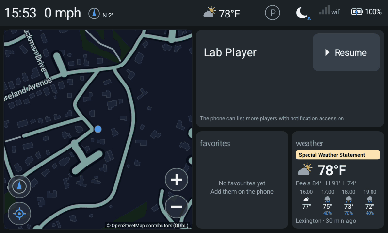
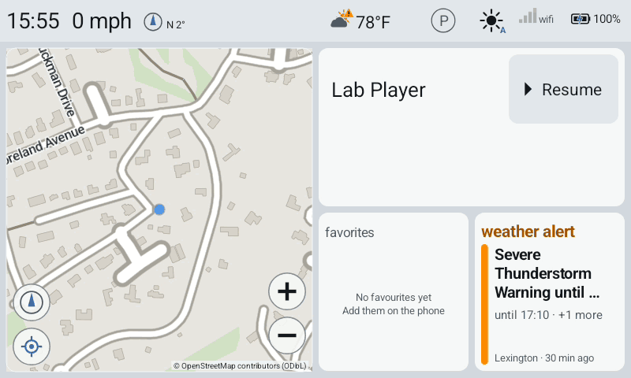

# P10 in the emulator lab — `LAB_WEATHER`, the stand-in Breezy, the renders: lab record — 30 September 2026

Plan §8 of the [P10 plan](p10-plan.md), run: `LAB_WEATHER` in `tools/emulator-lab.sh` (the
`weather` script), a `weather` script in the lab receiver, the report's `weather_*` evidence, and
renders of the header item, the weather view and the alert view for James. It is the first time
P10 ran on ART against a provider across a process boundary.

Status: **all six plan §8 runs pass in the emulator lab** (show, tap, alert, stale, off,
notifier), and so does `unsupported`. They ran on the debug APK of build 8 (headerWeather 2.2
headers wide, glyph and text half a margin in), against the stand-in Breezy, with hand-written
fixtures. The runs found **two app defects and two fit problems** (§4). **All four are now
fixed** and re-run in the lab on build 10 (§6): the second alert waits for the first, the hour
row reads at 800x480, "old" shows, and the header draws a single dash. The renders in
`docs/images/p10/` are the re-runs'. **Nothing has run against the real Breezy, on the Pixel or
on the truck, and nothing was heard.**

---

## 1. What was built

### 1.1 `LAB_WEATHER` — `tools/emulator-lab.sh`, the `weather` script

`LAB_WEATHER=<mode>` on its own (or the `weather` script) runs it. `LAB_MAP` is optional and
gives the map pane a picture. The script's header documents every mode. In all of them:

- **The stand-in Breezy** (`$OPENAUTO_CACHE/breezy-standin/breezy-standin.apk`, from
  `tools/breezy-standin.sh`) is copied into the run and installed **before the app**, so that
  `org.breezyweather.READ_PROVIDER` exists when the app is installed. Then
  `pm grant org.openautoandroid.source org.breezyweather.READ_PROVIDER`. The script
  installs it only on the emulator, which it boots with `-wipe-data`. Nothing here touches a
  phone.
- The scenario is chosen with
  `am broadcast --include-stopped-packages -n org.breezyweather/.ScenarioReceiver --es scenario <name>`,
  and the run fails unless the receiver answers `scenario <name>`.
- **Every provider query the stand-in answers is logged for the whole attempt.**
  `adb logcat -v time -s BreezyStandin:I` runs in the background from `logcat -c` onwards into
  `breezy-standin-log.txt`, so the count does not depend on what the logcat ring buffer keeps.
- The lab intent carries `lab_weather true` (`false` for `off`), `lab_weather_speak true` and
  `lab_weather_level severe`. They are saved before the attempt starts, so the projection
  reads them at its start.
- **Hand-offs with the receiver** go through two files in the results directory. The receiver
  appends what it has seen to `weather-receiver.txt` (`shown`, `notification`, `call`,
  `tapped`, `off-pressed`) and waits for `weather-lab.txt`, where the script appends what it
  has done (`cued`, `off-cued`, `notified <epoch ms>`). Before this, the receiver and the
  script coordinated only through the picture and the saved report, and neither can say
  "the receiver is ready for the call now".
- After the run, the receiver's container cuts each picture the receiver named
  (`receiver_weather=render <name> picture=N`) out of `video.h264` with
  `ffmpeg -vf select=eq(n\,N-1)` into `renders/<name>.png`.
- Every run checks that no place, coordinate, condition, headline or fixture text reached the
  report (`Lexington Goffstown Waco "LAB FIXTURE" "Partly cloudy" Thunderstorm "Flash Flood"
  "Special Weather" "Air Quality" Tornado "Weather alert." 42.4495 43.0206 31.5493 97.1467 °F
  Sendermarker Bodymarker`).

| Mode | What happens |
| --- | --- |
| `show` | `show` fixture (Lexington, 78°F, partly cloudy). The receiver checks the glyph in the header item and the text's clearance. It presses the item, the view opens, and it is framed in both palettes (renders). A second press closes it. |
| `tap` | The view is closed three ways: a second press, a press on the view, and 30 s untouched. It is opened a fourth time and a **modem call** rings over it (`adb emu gsm call 5551234`, the calls script's telecom route: `call_controls` and dashboard notifications seeded, notification access, `MANAGE_ONGOING_CALLS` by appops, the IPv6 pod network). The receiver presses the item during the call. The call is cancelled from the modem (`adb emu gsm cancel`), and the view must not come back. |
| `alert` | Dashboard notifications on. When the receiver has seen the item, the lab player posts one notification. When the receiver has seen that, the scenario becomes `alert` and is read at once (`lab_weather_cue`). The receiver checks that the alert takes the tile and the glyph gains its mark, then presses twice (two severe alerts) and checks that the notification returns. `LAB_WEATHER_VOICE=on` (the default) seeds `voice_guidance=true` and uses the speech script's silent stand-in engine and `lab_speech_bluetooth`. `off` seeds the toggle off. |
| `stale` | `stale` fixture: Waco, then Goffstown NH at 4 h old. 12 s after PROJECTING, once the vehicle's fix is in, a lab cue reads again. The view is framed in both palettes. |
| `unsupported` | `unsupported` fixture (provider 1.0). The view is framed in both palettes. |
| `off` | Show weather off. The receiver checks that no item is drawn and that a press where it would be opens nothing. The notifier and a lab cue are sent anyway. The stand-in must log **no** query. Afterwards, a `lab_weather_capture` (a debug read that ignores the setting) must appear in the same log. That proves the log was listening. |
| `notifier` | `show`, then the scenario becomes `notifier` (64°F). The epoch time is stamped, then Breezy's notifier is broadcast to `.WeatherNotifierReceiver`. The receiver times the header's change against the stamp (at most 2 s). |

The speech-engine and Bluetooth-override code paths that were gated on `speech|voice` now use
one `SPEAKS` flag (speech, voice, weather alert). The modem and IPv6 network that were gated on
`calls` + telecom now also cover `weather` + `tap`. Neither changes what the older scripts do.

### 1.2 The receiver — `tools/lab-receiver/receiver.cpp`, `--script weather`

`--weather-mode show|tap|alert|stale|unsupported|off|notifier` and `--weather-dir <dir>`.

- `DashboardPane` mirrors **`DashboardLayout.headerWeather`**: `header*22/10` wide, its right
  edge a margin left of Ⓟ (`pauseBox`), full header height. Its presses landed at the centre
  of the app's own target at every size: 412,0+116x53 at 800x480, 380,0+116x53 in the 726x480
  content, and 1028,0+264x120 at 1920x1080.
- **Warm** pixels (U < 100, V > 145) are the glyph's sun (#D98200 by day, #FFC94D at night) and
  an alert's orange (#FF8C00). Nothing else in the header, an empty tile or a notification row
  has that colour. **Dark red** (#8B0000, the second lab alert's bar) is counted separately.
- **Header ink:** the header strip's background is its commonest luma. A column is ink if any
  pixel in it differs from that by more than 40. The line reports where the text's ink ends
  (`text_right`), the weather item's ink extent (`item`), and `clear`, the empty columns
  between the text and the item's box. `clear >= 2` is a check whenever the item is shown. It
  also reports each part's peak contrast, which is how "dim" is measured.
- Open and closed are judged on the flex tile. Open means ≥ 10% of the tile changed, plus the
  glyph's warm pixels for the partly cloudy fixture. A status-line view (`unsupported`) changes
  about 6%, so 3% is used for it. Closed means ≥ 10% changed back and no warm pixels left.
- The timeout is measured from the press that opened the view to the first picture with the
  view gone, and must fall between 29.5 and 33 s. The notifier delay is measured from the
  lab's epoch stamp to the first picture whose header item changed, and must be ≤ 2,000 ms.
- `receiver_weather=summary` lists every step's verdict.

### 1.3 Commands

```sh
tools/breezy-standin.sh                      # once; emulator only
tools/lab-receiver.sh build
export LAB_MAP=$HOME/.cache/oaa-vtm/maps/massachusetts.map
flock ~/.cache/openauto-android/p10-lab.lock env LAB_WEATHER=show tools/emulator-lab.sh weather
flock ~/.cache/openauto-android/p10-lab.lock env LAB_WEATHER=show LAB_VIDEO_CONFIG=1920x1080 tools/emulator-lab.sh weather
flock ~/.cache/openauto-android/p10-lab.lock env LAB_WEATHER=show LAB_MARGINS=74x0 tools/emulator-lab.sh weather
flock ~/.cache/openauto-android/p10-lab.lock env LAB_WEATHER=tap tools/emulator-lab.sh weather
flock ~/.cache/openauto-android/p10-lab.lock env LAB_WEATHER=alert tools/emulator-lab.sh weather
flock ~/.cache/openauto-android/p10-lab.lock env LAB_WEATHER=alert LAB_WEATHER_VOICE=off tools/emulator-lab.sh weather
flock ~/.cache/openauto-android/p10-lab.lock env LAB_WEATHER=stale tools/emulator-lab.sh weather
flock ~/.cache/openauto-android/p10-lab.lock env LAB_WEATHER=off tools/emulator-lab.sh weather
flock ~/.cache/openauto-android/p10-lab.lock env LAB_WEATHER=notifier tools/emulator-lab.sh weather
flock ~/.cache/openauto-android/p10-lab.lock env LAB_WEATHER=unsupported tools/emulator-lab.sh weather
```

Results are in `~/.cache/openauto-android/emulator-lab/<UTC time>/`. The logs of these runs are
in `~/.cache/openauto-android/p10-lab-*.log`.

---

## 2. Results — plan §8

All runs used the build 8 debug APK, the default night palette unless noted, and 800x480 unless
noted. Each passing run exits 0 with `receiver_check_failures=0`.

| Run | Mode | Result |
| --- | --- | --- |
| 20260930T152234Z | show, 800x480 | **pass** (10 checks) |
| 20260930T152353Z | show, 1920x1080 | **pass** (10) |
| 20260930T152456Z | show, 800x480 with 74x0 margins (Ford's 726x480) | **pass** (10) |
| 20260930T152555Z | tap | **pass** (19) |
| 20260930T152730Z | alert, voice toggle on | **pass** (14); speech defect §4.1 |
| 20260930T152835Z | alert, voice toggle off | **pass** (14) |
| 20260930T152940Z | stale | **pass** (10); fit problem §4.3 |
| 20260930T153100Z | off | **pass** (8) |
| 20260930T153204Z | notifier | **pass** (8) |
| 20260930T153245Z | unsupported | **fail**: the receiver's 10% open threshold; the app did it right (§2.7) |
| 20260930T153512Z | unsupported, receiver threshold 3% for a status line | **pass** (10) |

### 2.1 show — the header item, the view, the text's clearance

- **The header draws the glyph and "78°F".** 56 warm pixels in the item at 800x480 night, 72 by
  day, 340 at 1080p.
- **The text does not reach the item**, in either palette:

  | Frame | Header text ends at x | Weather box starts at x | Clear columns | Item ink |
  | --- | --- | --- | --- | --- |
  | 800x480 | 233 | 412 | **178** | 419..494 of 412..527 |
  | 726x480 content (74x0 margins) | 265 | 380 | **114** | 387..461 of 380..495 |
  | 1920x1080 | 541 | 1028 | **486** | 1046..1221 of 1028..1291 |

  The parked header reads "15:23 0 mph ⊙ N 2°". A moving truck's longest line ("65 mph",
  "NNW 337°") is a few characters longer, which is tens of pixels at 800x480, well inside 114.
- **A press opens the view**: 21% of the tile changed and 132 warm pixels (the large glyph) at
  800x480, 3 pictures after the press. A second press closed it, 3 pictures later, with no warm
  pixels left.
- Report: `weather_enabled=true weather_permission=granted weather_provider=ok weather_reads=1
  weather_reading=true weather_reading_age_min=30 weather_hours=7 weather_alerts_held=4
  weather_alerts_qualified=0`, and from the dashboard `weather_shown=true weather_view_opens=1
  weather_view_closes_tap=1 weather_view_open=false`. The stand-in answered 3 version, 3 location
  and 3 weather queries. That is the projection's read plus the phone's Weather card reading
  its own (plan §4), since the card is on screen.

### 2.2 tap — closing three ways, and the call

```
opened-1 ok changed=0.209 warm=132        closed-by-second-tap ok (3 pictures after the press)
opened-2 ok                               closed-by-view-tap ok  (press at 697,370, the tile's centre)
opened-3 ok                               closed-by-timeout ok after_s=30.1
opened-4 ok, then the modem call          call-ringing ok changed=0.569 warm=0 (the view gone)
in-call-press-ignored ok changed=0.000    call-gone ok    view-not-back-after-call ok (6 s after)
```

- The dashboard's count: `weather_view_opens=4 weather_view_closes_tap=1
  weather_view_closes_view=1 weather_view_closes_timeout=1 weather_view_closes_call=1
  weather_taps_in_call=1 weather_view_open=false`, with "call ringing (telecom)" at +47.5 s
  and "call none" at +53.4 s.
- The press during the call did nothing to the picture: 0.000 of the tile changed, and Answer
  was still green. The call closing the open view (`closes_call=1`) is an addition to plan §8's
  list, and it passed too.
- Render: the tile with the ringing call and the header item beside it, after the press.

### 2.3 alert — over a notification, the mark, the voice, dismissal

Both runs (toggle on and toggle off) drew the same pictures:

```
notification-arrived ok changed=0.066
alert-took-the-tile ok changed=0.210 warm=2120      (the orange bar and the label)
header-warning-mark ok changed=0.0163 warm=56→96    (1.6% of the item, same palette)
second-alert-shown ok changed=0.137 dark_red=1492   (after the first press)
notification-back ok changed=0.000                  (after the second press: identical to before)
header-mark-stays ok changed=0.0163                 (plan §5.1: dismissing leaves the mark)
```

- **Toggle on:** `weather_alerts_qualified=2 weather_alerts_asked=2 weather_alerts_requests=2
  weather_alerts_started=2 weather_alerts_completed=1 weather_alerts_interrupted_by_alert=1
  weather_alerts_skipped_toggle_off=0 speech_gate=lab`, and "weather alert spoken" twice,
  7 ms apart. The stand-in engine was handed utterances of **60 and 53 characters**. That is
  "Weather alert. " plus each headline, well under the 400-character cap. **The first was
  cut off by the second** (§4.1).
- **Toggle off:** `weather_alerts_started=0 weather_alerts_skipped_toggle_off=2`, "weather
  alert not spoken (toggle_off)" twice, and the tile, the mark and the dismissals exactly as
  with it on.
- Both: `weather_alerts_shown=2 weather_alerts_dismissed=2 weather_lab_cues=1 weather_reads=2
  weather_alerts_held=6`. Neither the headline nor the notification's sender or text is in the
  report.
- Order: the Severe Thunderstorm Warning (#FF8C00, ends in 75 min) showed first with "+1 more".
  The Flash Flood Warning (#8B0000, ends in 180 min) came second. Equal severity, ending soonest
  first, as in plan §5.3.

### 2.4 stale — old and far

- After the lab cue, the read chose **Goffstown NH**, the location nearest the vehicle's fix.
  The report says `weather_far=true weather_reading_age_min=240 weather_provider=ok
  weather_lab_cues=1`.
- **Dim:** the header item's peak contrast fell to 111 against the text's 180 at night (124
  against 180 by day). For comparison, the fresh item in `show` measured 180. The view is
  dimmed throughout.
- The view's place line reads **"Goffstown · 74 km away · 4 h…"**. The app computes 74 km
  from the lab's parked fix (42.4242, −71.2121), not the 70 km the brief estimated. The
  ellipsis cuts off "ago · old" at 800x480 (§4.3). The header item has no text label; it is
  only dimmed, which is what plan §5.1 says.

### 2.5 off — no item, no query

- No warm pixel and **no ink at all** in the item's box (`item=-1..-1`). The header text ends
  at x=233, the same as with weather on, so the text runs as it does today.
- A press where the item would be changed **0.000** of the tile.
- The notifier broadcast and a lab cue were sent mid-projection. `weather_enabled=false
  weather_reads=0 weather_notifier_cues=0 weather_lab_cues=0 weather_shown=false
  weather_view_opens=0 weather_reading=false weather_provider=not_read`.
- **The stand-in logged 0 queries during the attempt.** The capture after it was logged (3
  queries), so the log was listening.

### 2.6 notifier — within 2 s

- The scenario changed to `notifier`, the time was stamped, and
  `am broadcast -a org.breezyweather.ACTION_UPDATE_NOTIFIER -n org.openautoandroid.source/.WeatherNotifierReceiver`
  was sent: "Broadcast completed: result=0".
- The header item changed (4.4% of it: 78 → 64) **195 ms** after the stamp, including the
  broadcast, the read, the render, the encode and the decode.
- `weather_notifier_cues=1 weather_reads=2 weather_reading_age_min=1`. The stand-in answered 4
  weather queries (the start, the notifier, and the phone card's reads).

### 2.7 unsupported

- `weather_provider=unsupported_major weather_read_failures=1 weather_reading=false`. The
  stand-in answered **only `version`** queries, 3 of them, so nothing was read past the major
  check.
- The view says **"Breezy Weather version not supported (provider 1.x)"**, centred. The header
  item shows two dimmed dashes (§4.4).
- The first run failed on my receiver's threshold. The app counted the open and the close
  correctly (`weather_view_opens=1 weather_view_closes_tap=1`), but a status-line view changes
  only 6.1% of the tile. After the threshold for it was set to 3%, it passed.

---

## 3. The renders for James

Whole frames from the decoded video, at the picture the receiver named, in 64 colours. 1.2 MB
in all, in `docs/images/p10/`. **The view, alert, stale and unsupported renders were replaced
by the build 10 re-runs (§6)**; the bullets below describe the new ones. The off, notifier and
tap-in-call renders are still build 8's: none of them shows the view or a header with no
reading, so none changed.

| | Night | Day |
| --- | --- | --- |
| **View, 800x480** | [p10-view-800-night.png](images/p10/p10-view-800-night.png) | [p10-view-800-day.png](images/p10/p10-view-800-day.png) |
| **View, 726x480 (Ford margins)** | [p10-view-726-night.png](images/p10/p10-view-726-night.png) | [p10-view-726-day.png](images/p10/p10-view-726-day.png) |
| **View, 1920x1080** | [p10-view-1080-night.png](images/p10/p10-view-1080-night.png) | [p10-view-1080-day.png](images/p10/p10-view-1080-day.png) |
| **Alert, 800x480** | [p10-alert-800-night.png](images/p10/p10-alert-800-night.png) | [p10-alert-800-day.png](images/p10/p10-alert-800-day.png) |
| **Stale, 800x480** | [p10-stale-800-night.png](images/p10/p10-stale-800-night.png) | [p10-stale-800-day.png](images/p10/p10-stale-800-day.png) |

These are night only:
- [the notification before the alert](images/p10/p10-alert-before-800-night.png)
- [the second alert](images/p10/p10-alert-second-800-night.png)
- [the notification back, with the mark still on the header](images/p10/p10-alert-dismissed-800-night.png)
- [off](images/p10/p10-off-800-night.png)
- [after the notifier, 64°F](images/p10/p10-notifier-800-night.png)
- [the ringing call after the press](images/p10/p10-tap-in-call-800-night.png)
- [unsupported](images/p10/p10-unsupported-800-night.png)
- [the header and tile at 800x480, three times enlarged](images/p10/p10-view-800-night-zoom3x.png), where the
  hour row can be judged
- [the stale view, three times enlarged](images/p10/p10-stale-800-night-zoom3x.png), where "old" can be read
- [unsupported, three times enlarged](images/p10/p10-unsupported-800-night-zoom3x.png): one dash in the header




What they show:

- **Header item:** the partly cloudy glyph (cloud with the sun behind it) and "78°F", a clear
  gap before Ⓟ, and far from the text at every size. The glyph reads at 800x480. With an alert,
  a small orange triangle with "!" sits at the glyph's top right. It is legible but small,
  about 13 px at 800x480.
- **View:** the "Special Weather Statement" strip (the minor alert, below the Severe level,
  shown in the view only, as plan §5.2 says) in its moccasin colour. Below it: the glyph and
  "78°F" large, "Feels 84° · H 91° L 74°", the hour row, and "Lexington · 30 min ago". The
  condition text ("Partly cloudy") is left out under a strip; the glyph says it (§6.2). The
  tile label reads "weather".
- **The hour row reads** at every size: "16:00 17:00 18:00 19:00", a glyph, "77° 75° 73° 72°",
  and "40% 70% 40%" under the rainy hours in the accent blue. At 800x480 the hour is about
  11 px, the temperature 13 px and the rain 10 px (§6.2).
- **Alert view:** an orange bar down the left, the label "weather alert" in the alert's colour,
  and the headline in bold on three lines, cut at "Severe Thunderstorm Warning until …". Below
  that, "until 16:43 · +1 more" and "Lexington · 30 min ago". The second alert has a dark red
  bar; its headline fits on three lines, and it reads "until 18:28". Breezy's headline carries
  its own clock time ("until 9:45 PM EDT" in the fixture, which is a fixed string), and the
  view adds "until 16:43" in the phone's 24-hour format. With real data, both times will
  describe the same moment in two formats. That is for James to judge.
- **Stale view:** everything dimmed, "Cloudy", "H 66° L 52°", the hour row, and
  **"old · 74 km away · Goffstown · 4 h ago"** whole along the bottom, at 0.85 of the place
  line's size (about 10 px). The dimming is plain at night and subtle by day.
- **Off:** the header ends at "N 2°", with nothing between it and Ⓟ.
- **Unsupported:** the header shows a single dimmed "—" where the temperature goes, and no glyph.

---

## 4. App defects and fit problems found — all four fixed (§6)

### 4.1 Two alerts at once: the second cuts the first off (speech) — **fixed**

**Fixed on build 10.** Alerts now wait in a line behind a speaking alert as well as a turn
prompt, and are said in the order asked. The re-run said both in full:
`weather_alerts_started=2 weather_alerts_waited=1 weather_alerts_completed=2
weather_alerts_interrupted_by_alert=0` (§6.1). What follows is the finding as recorded.

`WeatherFeed.checkAlerts` (`WeatherFeed.kt:209`) asks `speak` for every newly qualifying alert
in one loop. `SpeechRules.alertGate` (`SpeechRules.kt:363-373`) makes an alert
wait only while a **turn prompt** (`current?.kind == SpeechKind.GUIDANCE`) is being said.
While another **alert** is being said, it goes straight to `speak`, and `began` ends the first
as `INTERRUPTED_BY_ALERT` (QUEUE_FLUSH).

In the lab both severe alerts qualified in one read, 7 ms apart. The engine was handed 60
characters and then 53. The Severe Thunderstorm Warning, which is the one the tile shows first,
was cut off after about 7 ms (`weather_alerts_interrupted_by_alert=1
weather_alerts_completed=1`). The Flash Flood Warning was the one heard. Plan §6 does not say
what two alerts at once should do, but losing the most severe, soonest-ending one cannot be
the intent.

Suggested change: in `alertGate`, treat `current?.kind == SpeechKind.ALERT` as a reason to wait,
as for GUIDANCE: set `pendingAlert` and return `Wait`, and let `Speaker` speak the waiting one
when the current alert ends. `waiting()` already returns null only for GUIDANCE, so it would
fire after the alert. Note that `pendingAlert` holds only one, so a third alert would be
`SUPERSEDED`. Alternatively, `WeatherFeed` could ask for only the first qualifying alert per
read and the rest one at a time. Either needs a host test in `WeatherTest` or the speech tests.

### 4.2 The four-hour row is too small to read (`WeatherDrawing.kt:109-137`, `drawView`) — **fixed**

**Fixed on build 10.** The row has a fixed share of the view (0.36 of its height with a rain
line, 0.30 without), and its text is about 11–13 px at 800x480 (§6.2). What follows is the
finding as recorded.

The row gets whatever height is left after the strip (0.16 h), the Now block (0.30 h), the
condition line and the detail line (0.23 h), and the place line (0.13 h): about 23 px of a
161 px tile at 800x480. `hourSize = rowH*0.2` and `tempSize = rowH*0.22` then come to **4–5
px**, and the glyphs to about 8 px. See the 3x enlargement. At 1080p the text is about 10 px of
1080. Without the strip and the feels line (the stale render) it is readable, just.

Suggested change: give the row a fixed share (about 0.3 h) and shrink the Now block to fit.
Or, when there is a strip, drop the condition text (the glyph says it) or merge it with the
feels and H/L line. Or show 3 hours rather than 4 (plan §11 lists 4 hours as open to change).

### 4.3 "old" never shows in the view at 800x480 (`WeatherDrawing.kt:143`, the place line) — **fixed**

**Fixed on build 10.** The flags now lead the line, and the view shrinks it or breaks it onto
two lines before it cuts anything. The re-run drew "old · 74 km away · Goffstown · 4 h ago"
whole (§6.3). What follows is the finding as recorded.

`fit(paint, it, w)` cuts "Goffstown · 74 km away · 4 h ago · old" to
"Goffstown · 74 km away · 4 h…". The word that says the reading is past the stale limit (plan
§2) is the one lost. A Texas place name like "Waco" is shorter, but a longer name will lose
the distance too.

Suggested change: put the flags first ("old · 74 km away · Goffstown · 4 h ago"), or use two
lines, or shrink the text to fit before cutting it.

### 4.4 No reading: two dashes in the header (minor) — **fixed**

**Fixed on build 10.** No glyph is drawn without a reading. The header item's ink went from
x=424..466 (two dashes) to 452..466 (one) in the `unsupported` re-run (§6.4). What follows is
the finding as recorded.

With no reading (`unsupported`, and also before the first read), the header item shows two
dimmed dashes: one in the glyph's place, one as the temperature. Plan §5.1 says 'a dimmed "—"
where the temperature goes'. Either leave the glyph slot empty or accept the pair. Noted for
James.

---

## 5. What was not done, and limits

- **Nothing heard.** The alert run used the lab player's silent stand-in engine (eSpeak NG is not
  in the cache). The evidence is Speaker's counts and the engine being handed 60 and 53
  characters.
- **Not exercised in the lab:**
  - an alert waiting for a turn prompt (it needs a route with prompts);
  - an alert cutting off a notification being read;
  - an alert during a call (`in_call`);
  - the 15-minute timer (`weather_timer_cues` stayed 0; no run lasted 15 min);
  - the `wrong_package` owner check (the stand-in has the right package, by design);
  - the permission prompt (the lab grants the permission with `pm grant`);
  - a revoked grant;
  - the Setup item and the phone's Weather card (`LAB_SCREENS` was not run with weather).
- **`tap` and `alert` ran at 800x480 only**, and so did stale, off, notifier and unsupported. The
  1080p and 726x480 runs are `show`. Pressing a target at other sizes is the same geometry, and
  the `show` runs landed at all three.
- The parked header's text is "0 mph" and "N 2°". The clearance for a moving truck's longer text
  is estimated in §2.1, not measured. `LAB_TRACK=1` under the weather script would measure it.
- The stand-in's query counts include the phone Weather card's own reads (`Weather.readOnce`)
  whenever the card is on screen and weather is on. Only `off`'s zero is a hard figure.
- The alert headlines, times and places are fixtures. Real Breezy blobs (P10.0) decide what the
  headline and "until" look like together.

---

## 6. Re-runs after the fixes — build 10, 30 September 2026

§4's four findings were fixed in the app, built, and re-run in the lab. Build 9
(`~/.cache/openauto-android/p10-fix-build.log`) had the first version of the view. Its
800x480 render put each hour's rain beside its temperature ("75° 40% 73° 70% 72° 40%"), where
it ran into the next hour's and could not be told apart. Build 10
(`p10-fix-build2.log`) gives the rain a line of its own. Every run below is on build 10's
debug APK. Both builds exit 0 with lint, `verify-apk` on all three APKs, and all 29 host
tests: 11,558 checks, of which WeatherTest has 274 (259 before).

| Run | Mode | Result |
| --- | --- | --- |
| 20260930T155239Z | show, 800x480 | **pass** (10 checks) |
| 20260930T155340Z | stale, 800x480 | **pass** (10) |
| 20260930T155457Z | alert, voice toggle on | **pass** (14); both alerts said in full |
| 20260930T155602Z | show, 800x480 with 74x0 margins (Ford's 726x480) | **pass** (10) |
| 20260930T155702Z | show, 1920x1080 | **pass** (10) |
| 20260930T155803Z | unsupported | **pass** (10) |

The commands are §1.3's. The logs are `~/.cache/openauto-android/p10-lab-fix2-*.log`. The
receiver's checks did not need changing. It judges the view by how much of the tile changed
and by the glyph's warm pixels, and the new layout still changes 17–21% of the tile (20.2% at
800x480, 21.1% at 726x480, 17.2% at 1080p) with the large glyph's sun in it.

### 6.1 Alerts queue; they don't supersede (§4.1)

- **`SpeechRules.kt`:**
  - `SpeechQueue.pendingAlerts` is a first-in, first-out line of alert keys. It replaces the single `pendingAlert`.
  - `alert()` makes an alert wait while a turn prompt or another alert is being said, and while others are already waiting.
  - `waiting()` hands the next one out once neither is being said, gated afresh.
  - A repeated key is held once.
  - The `superseded` skip is gone. Alerts still waiting when the projection ends are counted as `weather_alerts_skipped_session_end`.
- **`Speaker.kt`:**
  - `waitingText` is a key-to-words map.
  - `releaseWaiting()` releases the next alert each time an utterance ends. If that alert is skipped (the toggle, a call or the gate changed while it waited), it is counted and the one after is tried.
  - The event log says "weather alert waiting its turn".
- **`WeatherFeed.checkAlerts` is unchanged.** It asks in the tile's order, and that is now the order they are said in.
- A notification tapped while alerts wait follows the old rules. It is dropped while a prompt or an alert is being said.
- **The re-run:**

  ```
  +8578ms weather alert spoken
  +8586ms weather alert waiting its turn
  +10380ms weather alert spoken
  weather_alerts_requests=2 weather_alerts_started=2 weather_alerts_waited=1
  weather_alerts_completed=2 weather_alerts_interrupted_by_alert=0 weather_alerts_skipped_session_end=0
  emulator-lab: the stand-in engine was handed utterances of 60 53 characters
  ```

  The Flash Flood Warning waited 1.8 s for the Severe Thunderstorm Warning to finish on the silent stand-in engine, then was said.
- The tile, the mark and both dismissals passed as before (`alert-took-the-tile`, `header-warning-mark`, `second-alert-shown`, `notification-back`, `header-mark-stays`).
- **Host tests (WeatherTest, `alertsAreSpokenByTheRules`):**
  - Two alerts in a row: the second waits and goes once the first completes, with `interrupted_by_alert=0` and `completed=2`.
  - Three queued behind a prompt: they go one at a time, in order, with none cut off.
  - The session ends with two waiting: `skipped_session_end=2`, and none started.
  - The older check, where a second alert waited "in its place", now expects it to wait behind the first. Turning the toggle off releases both as `toggle_off`.

### 6.2 The hour row has a fixed share (§4.2)

`WeatherDrawing.drawView` now lays the view out from the bottom up:

1. The place line along the bottom (§6.3).
2. The hour row above it. It gets a fixed **0.36 of the view's height** when any hour has a
   rain line, and 0.30 otherwise.
3. The strip along the top.
4. The "Now" block (glyph and temperature), which gets what is left, up to a third of the
   view.
5. The text lines under the Now block. **Under a strip the condition text ("Partly cloudy") is
   left out**, because the glyph says it. The feels, high and low line stays.

Each hour's cell reads, top to bottom:

- the hour;
- the glyph;
- the temperature;
- the rain percentage, on a line of its own in the accent colour.

Build 9 put the rain beside the temperature. That fitted the width, but read as one run of
numbers across the row.

At 800x480 the view is 174x153 and the row about 55 px. In it, the hour text is about 11 px,
the temperature 13 px, the rain 10 px, and the glyphs about 16 px. At Ford's 726x480 the view
is 158x156, about the same. At 1080p (415x340) the text is about 22–28 px. The worst case is a
strip together with a place line on two lines. At 800x480 that would leave the Now block about
21 px, which the lab has not drawn.

Renders: [800x480 night](images/p10/p10-view-800-night.png), [day](images/p10/p10-view-800-day.png),
[three times enlarged](images/p10/p10-view-800-night-zoom3x.png);
[726x480 night](images/p10/p10-view-726-night.png), [day](images/p10/p10-view-726-day.png);
[1080p night](images/p10/p10-view-1080-night.png), [day](images/p10/p10-view-1080-day.png).
Every hour, temperature and percentage is readable in each of them.

### 6.3 "old" survives (§4.3)

- **The wording.** `WeatherText.placeLine` now puts the flags first: "old · 74 km away · Goffstown · 4 h ago". A fresh, near reading is unchanged ("Lexington · 30 min ago"). WeatherTest's two place-line checks follow the new wording.
- **The drawing** (`placeLayout`, used by both views):
  1. It draws the line whole at its size if it fits.
  2. Otherwise, it shrinks the line to no less than 0.85 of that size.
  3. Otherwise, in the weather view, it breaks the line into two at a " · ". The alert view cuts instead.
- **The stale re-run** drew **"old · 74 km away · Goffstown · 4 h ago" whole on one line**, at step 2 (about 10 px). The two-line step has not been drawn in the lab. A longer place name would reach it.
- **Everything else passed as before:**
  - `weather_far=true weather_reading_age_min=240`;
  - the header item dimmed (contrast 111 against the text's 180 at night, 124 by day);
  - the view opened (13.2% of the tile changed).
- **Renders:** [night](images/p10/p10-stale-800-night.png), [day](images/p10/p10-stale-800-day.png), and [three times enlarged](images/p10/p10-stale-800-night-zoom3x.png).

### 6.4 One dash with no reading (§4.4)

`WeatherDrawing.drawHeaderItem` draws no glyph when there is no reading, only the dimmed "—"
where the temperature goes (plan §5.1). The `unsupported` re-run shows it:

- The header item's ink is x=452..466. Build 8 had 424..466: a dash in the glyph's place and one for the temperature.
- `weather_provider=unsupported_major`.
- The view's status line opened as before (6.1% of the tile).

Render: [three times enlarged](images/p10/p10-unsupported-800-night-zoom3x.png).

### 6.5 Not re-run

- `tap`, `off` and `notifier` were not re-run. None of them draws the view's layout or a header with no reading, and the speech change does not reach them.
- `alert` with the voice toggle off was not re-run. With the toggle off an alert is skipped before any waiting, so nothing new is on that path.
- Still not exercised in the lab:
  - an alert waiting behind a turn prompt;
  - three alerts in one read;
  - the session ending with alerts waiting.

  Those are host-tested only.
