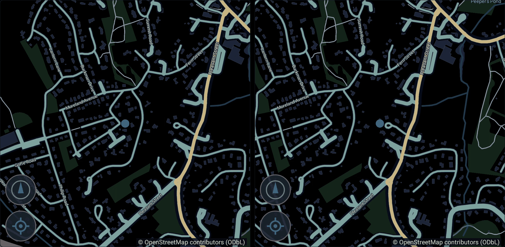

# P6.1 — a moving position source in the lab: implementation record — 20 September 2026

The slice the [P6 plan](p6-plan.md) §7 puts first, and the only one in P6 that builds no
navigation at all. Its subject is the lab: until today every run this project has ever
made reported **one fixed position**, so the owned map had never moved, and the parts of
the source that exist to follow a vehicle had never been asked to do anything.

Status: **implemented and lab-verified**, on the emulator at 1920x1080 against the
controlled receiver. It is not vehicle evidence and it does not pass **G8** — see §6.

---

## 1. What was missing, precisely

P5.5's own honest list (p5-5-results.md §7) put it plainly: *"Only one position was ever
rendered."* Three consequences, all of them invisible to a build, a lint or a host test:

- **Steady-state redraw was never exercised.** The measured `drawn=48 reused=830` was read
  as a parked vehicle costing nothing, which it is — and also means the map stopped
  rasterising once its tiles loaded and nothing ever made it start again.
- **Heading and speed had one value each**, and that value was the same in every run.
- **Nothing had ever followed anything.** "Follows the fix" and "ignores the fix and stays
  put" produce identical pictures when the fix never changes.

## 2. What was built

### 2.1 The track player (`tools/lab-receiver/receiver.cpp`)

A vehicle that sits at the kerb and then drives away, played into the sensor channel.

**Every value is integrated from the one before it** — the next position is the previous
one advanced along the current heading at the current speed, on a sphere. That is what
makes position, speed and bearing consistent *by construction* rather than by agreement:
a player reading three independent tables could publish a vehicle heading north at 13 m/s
whose coordinates went east, and nothing downstream has any second source to catch it
with.

- **The route**: four legs (200 m east, 150 m north, 200 m west, 150 m south) repeating,
  at 13.4 and 9 m/s (48 and 32 km/h), with **driven corners** — 30°/s, about three
  seconds for a right angle — and 2 m/s² of acceleration between leg speeds. Corners are
  driven rather than teleported because a source that only re-rotated on a large heading
  change would pass against a track that jumped.
- **The rates are the vehicle's own.** The G6/G7 runs recorded **208 LOCATION events
  against 42 CAR_SPEED and 42 GPS** in one 40.8 s session, so the lab sends a position
  every **200 ms** and a speed/satellite message every fifth one. The 5:1 split matters
  more than either rate: it is what produces a message *carrying no position at all*,
  which the source has to merge into the fix it already holds rather than read as a
  vehicle at 0,0.
- **The scales**, printed in the report rather than assumed by either side: position at
  1e7, bearing in thousandths of a degree, speed in millimetres per second. None of them
  is measured from a vehicle — Ford was stationary for the whole P5.2 harvest, so its
  speed was 0, which is 0 at every scale. The lab's are deliberately unequal to Ford's
  (whose bearing reads as 1e6) so a source that hardcoded either fails here.
- The vehicle stays **parked until the script releases it**, so a run starts from exactly
  the picture the old fixed fix produced.

### 2.2 The `track` script, and why it reads pixels

The check cannot be a counter. Every phone-side number — frames rendered, positions
received, camera moves — reads the same whether the pane rasterised a new view or
re-composited the old texture, which is the failure this slice exists to make visible. So
the receiver measures its own decoded pictures:

1. Sample the map pane once a second until it **goes quiet** — tiles arrive on VTM worker
   threads and change the pane on their own, and a baseline taken during that would
   measure the loading rather than the vehicle. The quiet itself is checked: a parked map
   must change less than 2% of the pane.
2. Release the vehicle, and after ~120 m of driving compare the pane again.
3. Do it a **second** time. A map that redraws once and then goes quiet is not
   hypothetical — it is P5.5's third defect, where tiles finishing on worker threads never
   woke the pane again — and one before-and-after pair cannot tell that apart from a map
   that keeps following.

At each step the **tile row on the other half of the dashboard** is measured too. It reads
"not configured" for the whole session, so it must not change; without it, a picture where
every pixel changes every frame — a broken encoder, a decoder producing noise — would read
as a following map. The pane rectangles mirror `DashboardLayout` field for field
(`DashboardPane::of`), and the app's own `dashboard_layout=` report line is what they are
checked against.

### 2.3 The host-side half

- `tools/hu-sim`: a `Track` that steps east one fix per media unit, with the same 5:1
  position-to-speed ratio. No clock, so the arithmetic runs the other way round —
  longitude advances by exactly the distance the reported speed covers in the reported
  interval.
- `core/aap-session/tests/projection.rs`:
  `a_moving_head_unit_delivers_every_fix_and_speed_alone_keeps_the_position` — every fix
  reaches the app, the positions are monotonic, and a speed-only message leaves the fix
  alone instead of replacing it with an empty one, which on a real drive would put the map
  in the Gulf of Guinea once a second.
- `tools/jni-host-test/DashboardTest.java`: `aMovingVehicleCarriesTheMapWithIt` and
  `theScaleComesFromTheDriveNotFromOneMessage` (§4.2). 196 dashboard checks, up from 149.
- `app`: `MapEngine.moved`, in the `map_engine=` report line. Rasterisations alone cannot
  say whether the map *followed* anything — tiles landing raise `drawn` on their own — so
  this counts applied changes of camera position, which a moving vehicle produces and a
  parked one does not.
- `tools/emulator-lab.sh track`: requires `LAB_MAP` (with no map data the pane draws a
  message, and a message does not move), and asserts the source's own account of the drive
  beside the receiver's picture-side check.

## 3. The run — 20 September 2026, pass

`LAB_MAP=massachusetts.map LAB_VIDEO_CONFIG=1920x1080 tools/emulator-lab.sh track`, the
same 201 MB extract P5.5 used, `$OPENAUTO_CACHE/emulator-lab/20260920T230747Z`.

```
receiver_track_panes=map=20,140+930x460 tiles=970,610+930x450 map_on_left=true interval_ms=200
receiver_track=parked map_changed=0 settle_s=5 fixes=24 frames=120
receiver_track=departed
receiver_track_moved=1 metres=123 map_changed=0.48989 tiles_changed=0 speed_ms=13.4 bearing=90 fixes=86
receiver_track_moved=2 metres=122 map_changed=0.493866 tiles_changed=0 speed_ms=9 bearing=0 fixes=137
receiver_track=fixes=148 speed_events=29 interval_ms=200 travelled_m=264 corners=1 speed_max_ms=13.4 scales=position:1e7,bearing:1e3,speed:1e3
receiver_video_decoded_frames=861 receiver_video_configs=1 receiver_video_decode_errors=0 receiver_video_size=1920x1080
receiver_checks=12 receiver_check_failures=0
```

A parked map changed **0.0%** of its pane over two seconds and settled in 5 s; a driving
one changed **49%** of it per 120 m, twice, while the static half changed **0.0%** both
times. That contrast is the whole result: the same picture, the same encoder, the same
decoder, and the only difference is that the vehicle moved.

The source's own account of the same 28.9 s:

```
projection_frames_rendered=863 projection_submitted=863 projection_accepted=862 projection_dropped_congested=0
projection_scene=dashboard chrome_uploads=126
map_engine=vtm-0.25.0 pane=930x920 theme=oaa-dark data=region.map drawn=289 reused=574 moved=124 error=-
dashboard_position_source=vehicle dashboard_vehicle_events=135 dashboard_vehicle_fix=true
dashboard_bearing_divisor=1000.0 dashboard_bearing_validated=true dashboard_car_speed_divisor=1000.0
sensor_value_001=LOCATION requested=true count=148 last=latitude=redacted longitude=redacted accuracy=8 altitude=213 speed=9000 bearing=0
```



The map pane out of the app-encoded stream, nine seconds and twenty-seven seconds into the
same capture: the street network has slid west under a marker that stays at the pane
centre, and Peepers Pond and the river have come in from the right. Not a phone screenshot
— decoded by the lab receiver out of the H.264 the app produced.

### 3.1 What a moving map costs, measured for the first time

| | P5.5, parked (1080p) | P6.1, driving (1080p) |
| --- | --- | --- |
| Frames | 878 in 30 s (~29 fps) | **863 in 28.9 s (~30 fps)** |
| Map rasterisations | 48 | **289** against 574 reuses |
| Camera moves | — (not counted) | **124** |
| Chrome uploads | 2 | **126** |
| Dropped or congested | 0 | **0** |

Two things worth carrying into P6.5. The map rasterises **more than twice per camera
move** — 289 against 124 — because panning into new ground makes VTM's loader threads ask
for redraws of their own, so the cost of a moving map is not the fix rate. And the chrome
is re-uploaded about **once per fix**: the header carries speed and a compass, both of
which change with every position, where a parked session uploaded it twice in total. At
1080p in an emulator with a software encoder, both together still held 30 fps with nothing
dropped.

## 4. The lab is the lab, and it found two defects the first time it ran

Neither was in the map.

### 4.1 A drive longer than a minute was an invalid configuration

The **first run never reached PROJECTING at all**: `final_category=NATIVE_START_FAILED
final_detail=INVALID_CONFIG`, before a single byte of projection.

`projection_ms` is documented as `1..=3600000` and had a guard rejecting anything over an
hour — but it was parsed through `wait()`, which caps *every* millisecond value at 60 s.
So the hour-long guard could never fire, and everything between 60001 ms and the
documented hour failed the whole configuration instead. Nothing had noticed because no lab
run had ever wanted more than a minute of projection; a 90 s drive is a perfectly ordinary
length for one. `core/aap-jni/src/manager.rs` now bounds it itself, and
`projection_config_keys_are_strict` covers 90 s and the hour.

### 4.2 A drive that ends pointing north reported the wrong scale

The first *passing* run reported `dashboard_bearing_divisor=1.0` after 144 fixes of
thousandths of a degree. The last fix of the lap was `bearing=0` — the vehicle came back
round to north — and `0` is zero degrees at every candidate scale there is, so a rule that
read each message on its own took the smallest that fit, which is 1.

This is the same class of problem as the one P5.5 fixed by trying divisors smallest-first,
one step further out: **a scale is a property of the head unit, not of a message**, and a
single message often cannot identify it. At the lab's 1e3 bearing scale every raw value
from 1 to 360 is also a plausible whole-degree bearing. Two things follow, and only the
first was observed:

- **Observed**: the report misstated the head unit's scale, and the header's "scale
  inferred" mark — which exists to tell the driver a number rests on arithmetic — would
  have switched itself off at the same moment, because the divisor had become 1.
- **Reasoned, not observed**: a vehicle *crawling* would read far worse. At 1e3, a speed of
  0.05 m/s is sent as `50`, which on its own is a perfectly good 50 m/s — 112 mph on the
  header of a car in a car park. This track never produced one, because it accelerates at
  2 m/s² and its first moving fix is already 0.4 m/s.

**The fix**: `ScaleVotes` in `VehicleReading.kt`. Each reading endorses *every* candidate
divisor that could explain it — so `bearing=0` endorses all of them and argues for none —
and the field is read at the smallest scale that explains **four readings in five**. The
threshold is a judgement and is written down as one: fixes arrive five times a second, so
a fifth of them disagreeing is a real disagreement, while one reading in eleven is the
glitch it is meant to outvote. A value the settled scale cannot explain is still drawn and
still marked, exactly as before, rather than quietly rescaling the drive around itself.

An earlier attempt at this took the largest value seen instead of a vote, and is worth
recording because it looked right: one corrupt reading would have rescaled every reading
after it, silently, for the rest of the drive. The host check that caught it is in
`theScaleComesFromTheDriveNotFromOneMessage`.

**Re-run to confirm** (`20260920T230028Z`, and again in §3's run): same track, same ending
heading, `dashboard_bearing_divisor=1000.0 dashboard_car_speed_divisor=1000.0`.

## 5. Verification actually performed

- `tools/check.sh` — fmt, clippy `-D warnings`, `cargo test --workspace`, release build,
  generated-protobuf check. Green, offline.
- `tools/android-build.sh` — lint as errors, APK invariants (`verify-apk.sh`: one ABI, no
  `INTERNET`), 18 + 17 + 52 + 196 + 89 host JVM checks. Green, offline.
- `tools/lab-receiver.sh build` — the receiver compiles clean against the pinned Prodigy
  library.
- Four emulator lab runs at 1920x1080 with real map data. The first failed at §4.1 before
  projection started; the second passed its picture checks and produced §4.2 in its report;
  the last two pass with `receiver_checks=12 receiver_check_failures=0` and nothing
  outstanding, the second of them on the final build.

## 6. Not verified — the honest list

- **No vehicle. G8 is not passed and cannot be by this.** P6.1 *unblocks* G8 by making a
  moving map demonstrable at all; the gate asks for a factory head unit and an operator
  observation, and this is an emulator with a software encoder and a scripted receiver.
- **The track is synthetic, and so is its plausibility.** It drives a rectangle over a
  suburban street network with no regard for the roads under it; the vehicle goes through
  buildings. That is fine for what it tests — the map does not care — and useless for
  anything about snapping, which P6.5 will need a route for.
- **The picture check says the pane changed, not that it changed correctly.** 49% of the
  luma moved; nothing in the receiver knows whether the map is centred where the vehicle
  is. The marker's position is checked separately and only on the host
  (`aMovingVehicleCarriesTheMapWithIt`), in arithmetic, not in a picture.
- **The pane geometry is written twice from one reading.** `DashboardPane::of` mirrors
  `DashboardLayout`, and both came from the same source file, so a layout change breaks
  the check rather than being caught by it. The app's `dashboard_layout=` line makes the
  disagreement visible in a report, which is the mitigation, not a second opinion. Spec
  §8.1's rule is about head-unit behaviour and this is our own scene, but the shape is the
  same and worth naming.
- **The ambiguous sub-degree band was not driven.** Headings slew in 6° steps, so the track
  produces `0` and values above `6000` but never the 1..360 raw band where the reading is
  genuinely ambiguous. §4.2's rule is what covers it, and no run has exercised the rule on
  a value in that band — only on `0`.
- **No head unit has ever sent a moving position to this source.** The vehicle was parked
  for every one of the 208 LOCATION events P5.2 harvested. The speed scale in particular
  remains entirely unmeasured: the lab chose 1e3 and Ford has never sent a nonzero speed.
- **One map region, one theme, one resolution, and north-up.** The corner in the run turns
  the compass, not the map: a heading-up drive has never been rendered, only checked on the
  host.
- **The parked-map baseline is the emulator's**, where nothing else is running. A phone
  with other activity might not go as quiet.

## 7. Spec and plan amendments this needs

**Applied 22 September 2026** to `spec.md` and `plan.md` (or to the non-governed file named), with the rest of the queue.

`spec.md` and `plan.md` are governed. These sit behind the six P5.5 proposed and the six
in the P6 plan §9, all still unapplied.

1. **plan.md** — a `P6` section with a **P6.1** row: the synthetic track player, the
   `track` script, the source-side counters, implemented and lab-verified, with the two
   defects in §4 named. Its tasks may be checked: this slice's evidence is a lab run and
   the lab run exists.
2. **spec §11.1 / G8** — no change to the gate, but its evidence list should say that the
   *lab* half of "pans and follows vehicle position" is now demonstrable, so a G8 attempt
   is a drive and an operator observation rather than new work.
3. **spec §8.1** — the rule that came out of §4.2 is worth stating once in the spec, since
   it generalises past sensors: **a scale, like a flag's meaning, is a property of the head
   unit and is settled by a run, not by a message.** The existing rule says to act on what
   the head unit does rather than on what a field is named; this adds that one value is not
   a behaviour.

## 8. Research status

§2.1's rates are **measured from the vehicle** (reports a24db7e0 / 7f869585, 208 LOCATION
against 42 CAR_SPEED). Its scales are **chosen by the lab**, and the reasoning for each is
in the source beside it; only Ford's bearing scale (1e6) is measured, and it is the one
the lab deliberately does not use.

§3 is **measured on this machine**, 20 September 2026: two emulator lab runs, the numbers
quoted verbatim from `receiver.txt` and the saved app report. The image is a crop of two
frames the receiver decoded out of the app's own stream.

§3.1's comparison is **measured against P5.5's own recorded figures** at the same
resolution; the explanation of why rasterisations exceed camera moves is **reasoning about
VTM's loader threads**, not an instrumented count of where each redraw request came from.

§4.1 is a **failed run and its fix**. §4.2 is a failed *report line* from a passing run,
its fix, and a re-run that confirms it; the crawling-speed consequence in it is
**reasoned and explicitly not observed**.
