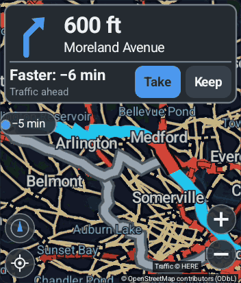

# P9 in the emulator lab — `LAB_TRAFFIC`, the stand-in HERE server, the renders: lab record — 28 September 2026

Plan §8 of the [P9 plan](p9-plan.md), run: a stand-in HERE server, `LAB_TRAFFIC` in
`tools/emulator-lab.sh` with checks 1–5, the report's `traffic_*` evidence, and lab renders
of the divided turn card for James (P9.6). It is the first time any of P9 ran on ART:
P9.1–P9.6 ([p9-1](p9-1-results.md), [p9-2](p9-2-results.md), [p9-5](p9-5-routing-results.md),
[p9-6](p9-6-dashboard-results.md), [runtime](p9-4-5-runtime-results.md)) were host-tested
only.

Status: **all five plan §8 checks pass in the emulator lab**, on the debug APK, against the
stand-in server, with hand-written responses. The run found four defects the host tests
could not (§4.1), and a code review found thirteen more (§4.2); all are fixed, with host
checks where they can be host-tested. **Nothing has run on the Pixel or the truck, and no
request has gone to HERE.**

---

## 1. What was built

### 1.1 The stand-in HERE server — `tools/here-standin/here-standin.py`

Python's standard library only, run in the emulator container inside the lab pod, on
`127.0.0.1:8765`, which the emulator reaches as `http://10.0.2.2:8765` (the debug build's
cleartext exception, and `TrafficClient`'s override, allow exactly that host).

- It answers exactly plan §4's two requests, `GET /v7/flow?in=bbox:W,S,E,N&locationReferencing=shape&functionalClasses=1,2,3&apiKey=K`
  and `GET /v7/incidents?in=bbox:…&locationReferencing=shape&apiKey=K`. A wrong key gets
  HERE's 401 shape (`{error, error_description}`); a malformed request, a box over 1°, or
  another path gets HERE's 400 shape (`{title, status, code, cause, action, correlationId}`).
  Bodies are gzipped when asked, as HERE's flow is, so the app's gzip path runs.
- It serves one **scenario** directory at a time, read from `/out/here/scenario` at every
  request, so the lab switches scenario while the app runs.
- It **counts every TCP connection it accepts**, not only requests, into
  `here/stats.txt` (`standin_connections requests flow incidents refused`), and logs each
  request with the key replaced by its length (`here/requests.log`). Check 5 is the
  connection count staying 0.

### 1.2 The scenarios — `tools/jni-host-test/LabTraffic.java`

A generator, like `LabDrive.java`, not a test. It computes BRouter's route from the lab's
parked position to Boston Common with the app's own `Router` over `W75_N40.rd5`, lays
hand-written HERE-shaped stretches on it (3 m to the right of OSM's line, as HERE's is a few
metres off), runs the app's own `TrafficMatch`, `TrafficNogos` and `AlternativeSearch` on
them, refuses to write a scenario that does not do what the lab relies on, and writes
`tools/here-standin/scenarios/{a,a2,side,b,empty}/{flow,incidents}.json`,
`scenarios/expected.txt` and `tools/lab-receiver/drives/traffic.csv`. Nothing in them came
from HERE: the geometry is OSM's (ODbL), every speed, jam factor and closure is made up.

```
java -cp <host-test classpath> LabTraffic <dir holding W75_N40.rd5> tools/here-standin/scenarios tools/lab-receiver/drives/traffic.csv
```

| Scenario | Flow | Incidents | What the host finds |
| --- | --- | --- | --- |
| `a` | slow 120–520 m ahead (5 m/s, jam 6: **amber**); a **queue** on the motorway 10,050–12,550 m (4 m/s, jam 8.8: **red**); the other carriageway's jam 25 m to the left, reversed (must not match); free flow after the queue | a **closure on a side road** 95 m from the route, clear of every way round | delay **513 s** (queue 495, slow 17); 39 points; two ways round, saving **385 s** and 314 s, leaving the route 698 m in |
| `a2` | the queue at 2 m/s (jam 9.6) | as `a` | delay 1,143 s; the way round saves 1,016 s, 631 s more than in `a` |
| `side` | the slow stretch only | the side-road closure | delay 17 s: no look, and no re-route |
| `b` | the route closed 250–480 m ahead (`traversability: closed`, no speed) | the side closure, and the same closure as an incident | closure run 238–492 m; BRouter round it: 21,945 m, 1,877 s, not through the closure |

The route is 19,659 m and 1,863 s (31 min). The alternatives search with `a`'s points took
7.5 s on the host.

### 1.3 `LAB_TRAFFIC` — `tools/emulator-lab.sh`, the `traffic` script

`LAB_TRAFFIC=<mode>` alone (or the `traffic` script) runs it; it needs `LAB_MAP` and
`LAB_ROUTING`. The script's header documents every mode. In all of them:

- The stand-in starts before the lab intent, which saves the stand-in's URL, the lab's own
  key (`labkey-p9-standin-7f3a`, looked for in the report afterwards), a 5-minute refresh, the
  4,500 limit and a cleared count, **with traffic off**; the receiver's parked vehicle is
  sent Boston Common as OsmAnd shares it.
- **Traffic is turned on 15 s after the route**, so the receiver has the route's picture
  and the cluster's time without traffic first; a scenario change is fetched at once by
  turning traffic off and on (`lab_traffic false`, then `true`).
- Mid-run snapshots of the report (`app-report-<name>.txt`, with its epoch milliseconds in
  `.time`) are taken after a debug-only `lab_report` intent that refreshes the dashboard's
  and the map's lines (§4.1, item 4).
- Every run checks that no key, stand-in description or id, reason word ("Queue on",
  "Traffic on", "Closed:", "Faster"), `bbox`, or coordinate of the start, the destination or
  the side closure reached any saved report or snapshot.

| Mode | Plan §8 | What happens |
| --- | --- | --- |
| `offer` | 1, 2, 3 | `a`; the receiver waits for the divided card, checks the map reframed, shows the card in the other palette and back, presses **Keep**; the script serves `a2` and turns traffic off and on; the receiver waits for the next offer and presses **Take** |
| `closure` | 4, and 5 mid-drive | `side`, then `b`; the receiver watches the closure's colour and the cluster; then traffic is turned off and the stand-in must hear nothing more |
| `off` | 5 | key and URL saved, the switch off; the vehicle drives 3 km of the route |
| `drive` | 1 on the move | `a`, then the vehicle drives through the slow stretch: colour, rebuilds, frame cost |
| `render` | P9.6 | `offer` as far as Keep, for the renders |

`LAB_OFFER_LAYOUT=side-by-side|stacked` goes to the app (the new debug extra
`lab_offer_layout`, which sets `DashboardLayout.defaultOfferLayout` before the projection's
layout is made) and to the receiver. `LAB_MARGINS=74x0` advertises Ford's margins on
800x480, the 726x480 content rectangle.

### 1.4 The receiver — `tools/lab-receiver/receiver.cpp`, `--script traffic`

`--traffic-mode offer|render|closure|off|drive`, `--offer-layout`, `--eta-out`.

- `DashboardPane` mirrors `DashboardLayout`'s offer geometry in both layouts (the whole map
  pane, `offerCard`, `offerPart`, `offerButton(0)` Take and `(1)` Keep, `offerView`). The
  presses landed on the app's own targets at both sizes: Take and Keep 100x48
  side by side and 74x48 stacked at 800x480, 91x44 and 67x47 at 726x480, the P9.6 record's
  sizes.
- Colours are counted in YUV off the decoded picture. **Amber** (`#F59A00`, U ≈ 48) is far
  from every colour of both map themes, so it is the colour check 1 counts. The queuing red
  sits next to the night theme's motorway red (§3), so it is only reported. The closure's
  dark red is counted in `closure` mode. **The offer is up** when Take is filled with the
  palette's accent and Keep is not.
- The parked vehicle never moves except in `off` and `drive`. It also never sends a
  changed fix, which is what found §4.1 item 1.
- Every change of the cluster's time to the destination goes to `receiver-eta.txt` (epoch
  ms, seconds, cluster states), with its first rise of more than a minute while the state
  held: live traffic's delay arriving.

After the run, the script sets the cluster's time at the moment of snapshot `a` against the
trip panel's (`dashboard_trip_seconds`, a new report field) and the cluster's rise against
`traffic_delay_s`.

### 1.5 Commands

```sh
export LAB_MAP=$HOME/.cache/oaa-vtm/maps/massachusetts.map LAB_ROUTING=$HOME/.cache/openauto-android/rd5
flock ~/.cache/openauto-android/p9-lab.lock env LAB_TRAFFIC=offer   tools/emulator-lab.sh traffic
flock ~/.cache/openauto-android/p9-lab.lock env LAB_TRAFFIC=closure tools/emulator-lab.sh traffic
flock ~/.cache/openauto-android/p9-lab.lock env LAB_TRAFFIC=off     tools/emulator-lab.sh traffic
flock ~/.cache/openauto-android/p9-lab.lock env LAB_TRAFFIC=drive LAB_DRIVE_SPEED=10 LAB_NIGHT=day tools/emulator-lab.sh traffic
flock ~/.cache/openauto-android/p9-lab.lock env LAB_TRAFFIC=render LAB_MARGINS=74x0 LAB_NIGHT=day tools/emulator-lab.sh traffic
flock ~/.cache/openauto-android/p9-lab.lock env LAB_TRAFFIC=render LAB_MARGINS=74x0 LAB_OFFER_LAYOUT=stacked tools/emulator-lab.sh traffic
flock ~/.cache/openauto-android/p9-lab.lock env LAB_TRAFFIC=render LAB_OFFER_LAYOUT=stacked LAB_NIGHT=day tools/emulator-lab.sh traffic
```

The receiver is rebuilt with `tools/lab-receiver.sh build`. Results are in
`~/.cache/openauto-android/emulator-lab/<UTC time>/`.

---

## 2. Results — plan §8 checks

All on the final debug APK (§5), 800x480 unless said, emulator lab on 28 September 2026.
Each run exits 0 with `receiver_check_failures=0`.

| Check | Run | Result |
| --- | --- | --- |
| 1 colour | `offer` 20260928T230102Z, `drive` 20260928T224354Z | **pass** |
| 2 time | `offer` 20260928T230102Z (and every `render` run) | **pass** |
| 3 offer, Take, Keep | `offer` 20260928T230102Z; Keep also in the three `render` runs | **pass** |
| 4 closure | `closure` 20260928T225826Z | **pass** |
| 5 off | `off` 20260928T224006Z; mid-drive in `closure` 20260928T225826Z | **pass** |

### 2.1 Check 1 — the route line changes colour there

- **Picture:** amber in the map pane went from **0 to 2,440 pixels** the moment traffic
  arrived (picture 807, 5 s after it was turned on), at the same parked street-zoom view.
  Driving through it (`drive`, day), up to 4,156, and the line behind the marker was cyan
  (frame 2100 of the drive run: [p9-traffic-route-800-day.png](images/p9/p9-traffic-route-800-day.png)).
- **App:** `traffic_runs=3 traffic_jam_runs=2 traffic_matched_m=4419`,
  `map_traffic_pieces=2 map_traffic_stale=0 map_traffic_layers=4`, `traffic_attributed=true`,
  `dashboard_traffic_attributed=true`. The other carriageway's reversed jam did not match
  (the delay is exactly the host's, below).
- On the drive, `map_traffic_rebuilds=12` for 3 km, `map_traffic_stale=0`.
- "Traffic © HERE" drawn above the ODbL credit in both palettes, at 800x480 and 726x480,
  clear of the − bubble (every render in §3).

### 2.2 Check 2 — the arrival time grows by the jam's delay

- `traffic_delay_s=513`: **the host's figure for the stand-in's jam to the second**
  (`expected.txt`: `a_delay_s=513`; the check allows ±60).
- The cluster's `destination_seconds`, decoded by the receiver, **rose 1,863 → 2,376 s**
  (+513 s) when traffic arrived, with the cluster's state unchanged.
- At snapshot `a`: cluster 2,376 s, trip panel (`dashboard_trip_seconds`) 2,376 s, BRouter
  1,863 s + traffic 513 s. **Equal.**
- The trip panel shows "arrive · +9 min traffic", the arrival 9 minutes later and 40 min to
  go (was 31); `dashboard_traffic_delay_min=9`.
- The same in each `render` run, at 726x480 too.

### 2.3 Check 3 — the offer, Take and Keep

- **The first offer** came 66 s after traffic was turned on: one fetch, one match
  (`traffic_match_ms=134`), and one alternatives search with the 39 points, **48.4 s in the
  debug emulator build** ("looked for other routes in 48394 ms: 1 shown −5 min; one offered
  for traffic"). "Faster: −6 min" (the host's 385 s), reason "Traffic ahead" (§3).
- **The map framed both routes:** the pane under the card changed 52% at the offer
  (`dashboard_offer_fits=2`; renders in §3).
- **Keep** at the receiver's computed Keep centre: the card whole again on the next
  decoded picture and the map back at street zoom (47% of the pane changed back);
  `traffic_offers_kept=1 dashboard_offers_kept=1`.
- **The second offer**, after `a2`: "17 min faster" 57 s after the fetch. Kept ways round are
  not re-offered unless 3 minutes better; this one was 11 minutes better, and came as a new
  offer (`traffic_offers_made=2 dashboard_offers_shown=2`).
- **Take**: the card whole at once, then "route requested … (request 2)" and "route computed
  in 3450 ms …: 20265 m, 1984 s … 39 traffic points". `routing_via=true`,
  `traffic_offers_taken=1 dashboard_offers_taken=1`, `dashboard_offer_refollows=2`.
- Traffic laid on the new route: 1 run, 17 s, so no "+N min" (under half a minute); the
  credit stays, since traffic shaped the route (`traffic_route_shaped=true`).
- Stand-in: 4 requests over 1 connection, none refused; the app counted 4
  (`traffic_requests_session=4`).
- **Withdrawal** (not a plan §8 check, seen on the `drive` run): an offer made while the
  vehicle drove towards the split was withdrawn when it passed it
  (`traffic_offers_withdrawn=1 dashboard_offers_withdrawn=1`, refollowed).

### 2.4 Check 4 — the closure moved onto the route re-routes

- With `side`: fetched and laid on (`traffic_closed_runs=0`, 2 of HERE's hard points on the
  side road's own shape, `traffic_nogos_hard=2`), **no re-route** (`traffic_closure_reroutes=0`).
- With `b`: "closure ahead on the route; re-routing round it" once, the cluster told
  **REROUTING then a new route** (states `1,3,1`), `routing_origin=closure`,
  **21,945 m and 1,877 s: BRouter's host route round it exactly**, with
  `routing_traffic_points=4 routing_through_closure=false`, `traffic_closure_reroutes=1`,
  `guidance_closure_reroutes=1`. The re-route took 3.5 s in the debug build.
- **The closure's colour in the picture:** 234 dark-red pixels in the map pane on the
  picture before REROUTING, 0 after the new route. It **renders as dashes**: dark red and
  near-white stripes across the line
  ([p9-closure-stipple-800-night.png](images/p9/p9-closure-stipple-800-night.png)), partly
  under the turn card, 250 m ahead.

### 2.5 Check 5 — with the setting off, no connection at all

- `off`: key and URL saved, the switch off, a route followed and 3,011 m driven with 957
  fixes: **`standin_connections=0`**, `traffic_requests_session=0 traffic_fetches=0
  traffic_held=false traffic_attributed=false routing_traffic_points=0`.
- Mid-drive (`closure`): traffic turned off after the re-route: `traffic_held=false` in the
  report 8 s later, and **no request in the 33 s after** (4 in all, before).

### 2.6 The report's `traffic_*` fields (plan §8)

From snapshot `a` of the final `offer` run:

```
traffic_enabled=true traffic_key=true traffic_refresh_min=5 traffic_look_ahead_km=30 traffic_limit=4500
traffic_following=true traffic_fetches=1 traffic_boxes=1 traffic_last_boxes=1 traffic_requests_session=2 traffic_requests_month=2 traffic_cap_reached=false
traffic_held=true traffic_last_fetch_age_s=6 traffic_response_age_s=5 traffic_failures=0 traffic_skipped=0 traffic_stale_drops=0 traffic_last_error=none
traffic_matched_m=4419 traffic_runs=3 traffic_jam_runs=2 traffic_closed_runs=0 traffic_delay_s=513 traffic_delay_min=9 traffic_match_ms=134
traffic_nogos=39 traffic_nogos_hard=2 traffic_nogos_on_route=20 traffic_requests_with_nogos=0 traffic_route_shaped=false traffic_route_closures_opened=false traffic_closure_reroutes=0
```

Enabled, cells (boxes), requests, last fetch, matched metres, delay, nogos, cap state: all
there, and none of the privacy markers.

### 2.7 Frame cost with the traffic layers

| Run | Frames | Time | Rate | Dropped | Map drawn / reused |
| --- | --- | --- | --- | --- | --- |
| `drive`, traffic on, 3 km through the slow stretch (12 rebuilds) | 10,544 | 351 s | 30.0 fps | 0 | 2,888 / 7,656 |
| `off`, traffic off, the same 3 km | 5,730 | 191 s | 30.0 fps | 0 | 1,892 / 3,838 |
| `offer`, parked, two fits | 5,684 | 190 s | 30.0 fps | 0 | 153 / 5,500 |

At 800x480 on the emulator's software renderer, up to 2 pieces (4 layers) cost no frames.
It says nothing about the Pixel at 1080p, which P9.7 must measure (plan §13 expects it).

---

## 3. The renders for James (P9.6)

The map pane at the offer, cut from the decoded video at the picture the receiver measured
it (the whole frame for the two route pictures). 64-colour PNGs, 475 KB in all.

| | Side by side (default) | Stacked |
| --- | --- | --- |
| **726x480 (Ford)**, day | [p9-offer-726-side-by-side-day.png](images/p9/p9-offer-726-side-by-side-day.png) | [p9-offer-726-stacked-day.png](images/p9/p9-offer-726-stacked-day.png) |
| 726x480, night | [p9-offer-726-side-by-side-night.png](images/p9/p9-offer-726-side-by-side-night.png) | [p9-offer-726-stacked-night.png](images/p9/p9-offer-726-stacked-night.png) |
| **800x480**, day | [p9-offer-800-side-by-side-day.png](images/p9/p9-offer-800-side-by-side-day.png) | [p9-offer-800-stacked-day.png](images/p9/p9-offer-800-stacked-day.png) |
| 800x480, night | [p9-offer-800-side-by-side-night.png](images/p9/p9-offer-800-side-by-side-night.png) | [p9-offer-800-stacked-night.png](images/p9/p9-offer-800-stacked-night.png) |




The route coloured, "Traffic © HERE" and "+N min traffic" on the trip panel:
[day, driving through the slow stretch](images/p9/p9-traffic-route-800-day.png) ("+8 min
traffic", the delay counting down as it is driven) and
[night, parked](images/p9/p9-traffic-route-800-night.png) ("+9 min traffic"). The closure:
[p9-closure-stipple-800-night.png](images/p9/p9-closure-stipple-800-night.png).

What they show, for the side-by-side or stacked decision (plan §11):

- **Side by side** keeps 293 px of map under the card at 726x480 against stacked's 249, and
  larger targets (91x44 against 67x47). It drops the street; "600 ft" sits under the icon.
- **Stacked** keeps the turn card exactly as it was, street and all, with a band beneath.
- Both read in both palettes; Take's accent fill is clear in each.

Seen in the renders, and left for James rather than changed:

1. **The ends of the routes can sit under the zoom stack.** The fit frames both routes into
   `offerView`, the pane under the card, which the − bubble and the credit overlap. At both
   sizes Boston Common is under the − bubble. Keeping the bottom corners clear would shrink
   the view by two bubble heights.
2. **At night the queue's red is close to the night theme's motorway red.** The dark edge
   separates them on the queue itself, but at the fitted zoom the jam is hard to pick out
   among the motorways. By day (red with a black edge on white roads) it stands out.
3. **The reason reads "Traffic ahead".** It is the generic wording: the map names no road at
   the queue (the motorway there has a `ref` and no `name` in this map; 20 of the route's 25
   stretches are named). Correct by P9.4's rule; a `ref` fallback in `StreetNames` would give
   "Queue on I 93".
4. **The offer's grey and a bubble's grey are the same.** The run also found a second way
   round, 5 minutes faster (not traffic's to offer), drawn as a "−5 min" bubble in the same
   grey as the proposal.

---

## 4. Fixes

### 4.1 Found by the lab

1. **A stopped vehicle had its traffic and its offer silently stop.** The session passes
   on a vehicle fix only when it changes (`VehicleState.merge`), so a vehicle stopped in a
   queue gives one fix and then nothing.
   - With the code review's fix 1 below, the route stopped being "followed" two minutes
     after that fix: no refresh, then the response dropped as stale at 10 minutes.
   - Separately, the traffic look (`LiveAlternatives.lookNow`) needed a fix to have
     reached `LiveAlternatives` for the new route (its token), which it never had: no search,
     no offer, ever (first offer run: `live_alternatives_looks=0` after 13 minutes).
   - Fixed: `TrafficHost.projecting()` (`Guide.attached`, true while a session is attached)
     keeps a route followed on its last fix while a dashboard projects; with no projection a
     fix within 2 minutes is still needed (`TrafficFeed.kt`, `Traffic.kt`, `Guide.kt`).
     `lookNow` takes up the new route's token itself when `Guide` follows it, and otherwise
     waits for the next fix on the route (`LiveAlternatives.kt`).
   - Host check: `TrafficFeedTest`, a stationary vehicle's route still refreshes while
     projecting. `LiveAlternatives` is Android; the lab's offer runs are its check.
2. **The saved report lagged the traffic.** It is written on each event, and the last one
   was "traffic fetched", before matching, so the report said `traffic_delay_s=0` for a
   route whose time already carried 513 s. `TrafficFeed.matched` now notes "traffic laid on
   the route: N runs, M min of delay ahead, P points" (counts only). The "live traffic off;
   traffic dropped" note now comes after the drop, so the report it writes says nothing is
   held.
3. **`dashboard_trip_seconds`**, the trip panel's time to the destination in seconds, is
   new in the dashboard's report line (`Dashboard.kt`), so check 2 can set the trip panel
   beside the cluster.
4. **The dashboard's and the map's report lines are taken only at the start and the end of
   a projection.** Mid-run snapshots showed `map_traffic_pieces=0` with the pieces drawn.
   Debug builds now take `lab_report` (`ConnectionActivity.kt`), which refreshes them through
   `ProjectionService.labReport` and notes it. `lab_offer_layout` is the other new debug
   extra (§1.3).

### 4.2 From the code review

Each was re-checked in the code before it was fixed.

| # | File | Cause | Fix | Host check |
| --- | --- | --- | --- | --- |
| 1 | `TrafficFeed.kt` | fetched whenever a route had any fix and was not arrived at: after the projection ended, and off the route | fetch only ON_ROUTE or JOINING, at a fix within `FIX_FRESH_MS` = 2 min (or while projecting, §4.1 item 1); `traffic_following` says the same | `TrafficFeedTest`: an hour of ticks with no fix fetches nothing; off-route fixes nothing; a fresh fix resumes |
| 2 | `TrafficClient.kt`, `ConnectionActivity.kt` | a debug build honoured any `baseUrl`, settable by any app through the exported activity, so the saved key could be sent anywhere | the override is honoured only for `10.0.2.2`, `127.0.0.1` and `localhost` with no user part (`TrafficClient.labBase`); the Traffic card says when one is in force | `TrafficClientTest`: seven overrides, lab hosts in, others (`10.0.2.2.evil.example`, a user part, a path) to HERE; never in release |
| 3 | `TrafficJson.kt`, `TrafficFeed.kt`, `Router.kt` | NaN, Infinity and 1e999 were read as coordinates and could fail `RouteRequest`'s `require` on the main thread | `optDouble` returns finite numbers only; points off the globe are dropped (not the stretch); the held points are filtered by `RouteRequest.valid` (now public) | `TrafficClientTest`: a stretch keeps its two good points of seven, an infinite speed is none; `TrafficFeedTest`: no point off the globe reaches a request |
| 4 | `TrafficMatch.kt`, `TrafficModel.kt`, `TrafficNogos.kt`, `TrafficFeed.kt` | a reversible or managed lane beside the route matched as CLOSED and could re-route and hard-block the interstate; one piece matched to a closure did the same | `reversibleNotRoutable` spans are skipped when matching the route (HERE-shape hard points stay); `closureAhead`, the route's own hard points and the "Closed:" reason need a closed run of `MIN_CLOSED_M` = 30 m (`TrafficRun.closes`) | `TrafficMatchTest`: a managed lane 12 m off is no closure and adds no own-line points; the general lanes' flow is what the route gets; a ramp closure matched for 20 m is drawn but not a closure ahead; one of 200 m is |
| 5 | `TrafficClient.kt` | the incidents request went out after traffic was turned off or the key removed mid-fetch | the gate is checked again, with the settings as they are, before every request | `TrafficClientTest`: off, and keyless, after the flow request: no incidents request |
| 6 | `TrafficFeed.kt` | a dropped generation's answer cleared `fetching` for the new one, so the next tick fetched twice | return before touching `fetching` on a generation mismatch (still counting what it sent) | `TrafficFeedTest`: the old answer lands, the new fetch is not started again |
| 7 | `TrafficFeed.kt` | a route merely faster in BRouter's model, with a little traffic, could be offered as traffic's | the traffic part, `min(saving, aheadDelay − ownDelay)`, must itself be ≥ 180 s | `TrafficFeedTest`: 100 s of queue and a way round 400 s BRouter-faster: not offered; 300 s of queue: offered |
| 8 | `LiveAlternatives.kt` | a traffic look was dropped when `Guide.position()` was null or the token stale, and not retried | kept pending and taken at the next fix on the route, bubbles on or off, if still worth it; see also §4.1 item 1 | Android class: the lab's offer runs |
| 9 | `Navigation.kt` | a closure re-route kept the chosen via point, which may lie beyond the closure: BRouter then opened the closure and the route could never leave it | a closure re-route drops the via point (noted) | Android class; `NogoRoutingTest` covers the routing |
| 10 | `TrafficClient.kt`, `ConnectionActivity.kt` | a `RuntimeException` from `HttpURLConnection` or the count's commit could crash the Test thread or the fetch thread | caught in `request()` (the message names the class only, never the key) and around `test()`; storing the error cannot throw out of `fail` | `TrafficClientTest`: a thrown `IllegalStateException` carrying the key is a failure without it; Test says so |
| 11 | `TrafficMatch.kt`, `TrafficNogos.kt` | a slow or queuing span at 0 m/s took BRouter's time: no delay and no weighted points | taken at `STOPPED_MPS` = 1 m/s | `TrafficMatchTest`: 1 km stopped is > 900 s of delay, on and off the route, with weighted points |
| 12 | `RoutePreview.kt` | the saved route lost "traffic-shaped", so the credit went after a restart | the route file (version 3) carries whether traffic shaped it and whether it goes through a closure; version 2 files are still read, without them | `RoutePreviewTest`: both flags cross the file; a version 2 file reads back without them |
| 13 | `TrafficSettings.kt` | a stored month later than the clock's (the clock set back) read as 0, a fresh cap | a later stored month keeps counting, and is kept on the next request | `TrafficClientTest`: October's 4,500 still refuses in September; August still resets |

---

## 5. Build

```
ROUTING_SEGMENTS=$HOME/.cache/openauto-android/rd5 flock ~/.cache/openauto-android/p9-build.lock tools/android-build.sh
```

**Exit 0** after every change above (`~/.cache/openauto-android/p9-lab-build3.log`): both
APKs, `lintDebug`, `verify-apk` on all three, and every host test with the tiles mounted,
among them `TrafficFeedTest` 198 checks (was 181), `TrafficMatchTest` 356 (345),
`TrafficClientTest` 186 (146), `RoutePreviewTest` 73 (70), `NogoRoutingTest` 68,
`DashboardTrafficTest` 2,084. `LabTraffic.java` compiles with the host tests under
`-Xlint:all -Werror`; it is run by hand, not by the build. The final lab runs in §2 used
this build's debug APK and the receiver built from this tree.

---

## 6. What remains

- **Pixel (P9.1):** the Traffic card's **Test** with James's real key works (James, 28
  September 2026). Still worth checking: the card never says "requests go to the lab's
  stand-in" (no override is saved on the phone).
- **Pixel, release build:** the alternatives search with points took 48 s here, in the
  debug emulator build (7.5 s on the host); debug builds route ~30x slower, so this is not a
  measurement. Time it in a release build, and `traffic_match_ms` (134 ms here).
- **Pixel at 1080p:** frame cost with the traffic layers (§2.7 is 800x480 on the emulator).
- **Truck (P9.7):** a real drive into real congestion: the colour and the time before the
  jam, whether the offered way round was worth it, and whether Ford sends a stopped
  vehicle's unchanged fixes (§4.1 item 1 covers it either way while projecting).
- **For James:** side by side or stacked (§3), and the four observations under it.
- **Not exercised in the lab:** a pan during an offer (host-tested), the 60 s re-fetch after
  a re-route out of the box (every route here stayed inside the first box), the monthly
  cap, HERE's error shapes from a live server (the stand-in serves them; no run asked for
  them), and more than one box.
- `tools/jni-host-test.sh`'s header needs a line that `LabTraffic.java` is a generator run by
  hand (the orchestrator's file).
